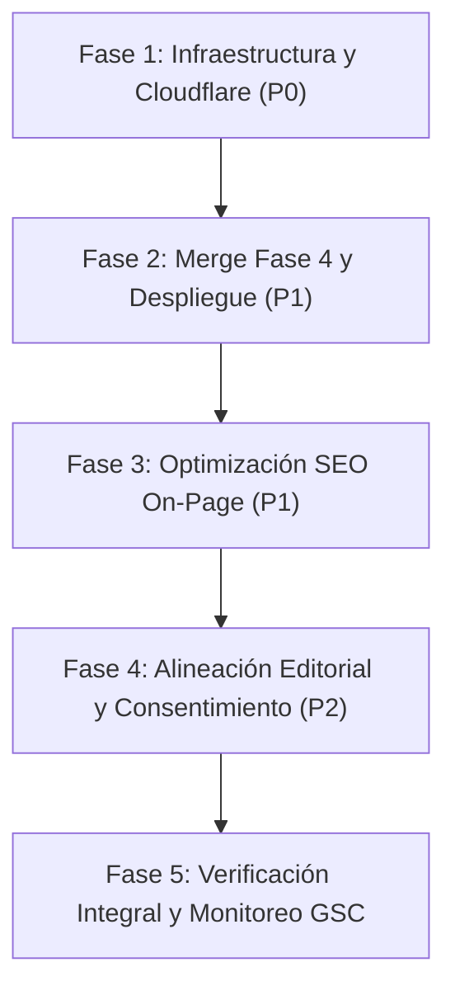

# Auditoría Técnica Integral y Estado de Situación — Reanudación Noviembre 2026
**Proyecto:** Razón y Asombro (https://razonyasombro.com/)  
**Fecha de Auditoría:** 16 de noviembre de 2026  
**Roles:** CTO · Senior Astro Engineer · SEO Technical Auditor · Especialista en Google Search Console  
**Rama de Inspección:** `fix/fase-4-coherencia` (Base `main` commit `ebd6a9a`, HEAD local y remoto `0cc8f5e`)  
**Repositorio:** `https://github.com/andrescarrizo1/sitio-catolico.git`  
**Estado del Working Tree:** Limpio (`working tree clean`, sin commits ni modificaciones aplicadas al código fuente)

---

## 1. Estado Real del Proyecto y Arquitectura

### 1.1. Repositorio, Ramas y Estado de Despliegue
- **Directorio de trabajo:** `c:\Users\Ryzen 5\Desktop\Pagina catolica`
- **Rama activa:** `fix/fase-4-coherencia` (sincronizada con `origin/fix/fase-4-coherencia` en commit `0cc8f5e`).
- **Rama productiva:** `main` (en commit `ebd6a9a`: *"merge: fases 1, 1b y 2 (SEO tecnico y estructura) en main"*).
- **Entorno de producción en Cloudflare Workers:** El pipeline de *Workers Builds* compila automáticamente a partir de los pushes a la rama `main`.
- **Divergencia Crítica Comprobada:** Los 8 commits de la rama `fix/fase-4-coherencia` (commits `0635d4e` a `0cc8f5e`, que incluyen la actualización del paper de la Sábana Santa a abril 2026, el desacoplamiento del pie cardíaco de `NextStep.astro`, la eliminación de textos de "Fase 1" y "chime" en la portada, y la función `isConcreteReviewer`) **aún no han sido fusionados a `main`**. Por lo tanto, el código activo en producción (`https://razonyasombro.com/`) corresponde a la Fase 2 (`ebd6a9a`), mientras que las correcciones de la Fase 4 permanecen en la rama de staging `fix/fase-4-coherencia`.

### 1.2. Pila Tecnológica y Arquitectura de Rutas
- **Framework:** Astro 7.4.1 (modo MPA estático, generación de 49 páginas HTML en `./dist`).
- **Estilos:** Tailwind CSS v4 (`@tailwindcss/vite` 4.0.6).
- **Componentes Interactivos (Islas):** Preact 10.25.4 (modo compatibilidad activado).
- **Motor de Búsqueda Estático:** Pagefind 1.3.0 (indexa 49 páginas en español e inglés).
- **Infraestructura Cloudflare:**
  - `wrangler.jsonc` con binding `ASSETS` apuntando a `./dist` y `run_worker_first: false`.
  - `src/worker.ts`: Worker en TypeScript que provee proxy y fallback para dos endpoints de IA (`/api/consuelo` y `/api/apologetica`), redirecciones 301 institucionales (`/santos/estudios-medicos-y-santo-oficio` y `/en/rosary`), cabeceras CSP diferenciadas para rutas `/embed/*` (permitiendo enmarcado en iframes de diócesis y parroquias) y captura de 404 personalizada.

### 1.3. Inventario de Páginas Generadas por Astro vs. Indexadas por Google
Es fundamental **no confundir una página generada por Astro con una página indexada por Google**:
- **Páginas HTML físicas generadas en `dist/`:** 49 páginas.
- **Páginas públicas canónicas indexables en Sitemap (`sitemap-0.xml`):** 46 páginas.
- **Páginas físicas no indexables (excluidas intencionalmente del sitemap):**
  1. `dist/404.html` (código de error con meta robots `noindex, follow`).
  2. `dist/parroquias/index.html` (borrador institucional con meta robots `noindex, follow`).
  3. `dist/embed/rosario/index.html` (widget para terceros con meta robots `noindex, nofollow`).
- **Estado en Google Search Console (según informe 5/11/2026):**
  - **Páginas indexadas:** 52
  - **Páginas sin indexar:** 41
  - **Total descubiertas por Google:** 93 URLs.

---

## 2. Problemas Confirmados con Evidencia Técnica

### 🔴 PROBLEMA CONFIRMADO 1 (P0): Servidor Cloudflare responde HTTP 200 en protocolo inseguro `http://` (Sin Redirección a HTTPS)
- **Evidencia Empírica de Terminal:**
  ```bash
  curl.exe -ILs http://razonyasombro.com
  # HTTP/1.1 200 OK
  # Date: Mon, 16 Nov 2026 05:24:58 GMT
  # CF-Cache-Status: MISS
  # Server: cloudflare
  ```
- **Diagnóstico Técnico:**
  1. En el panel de Cloudflare (zona DNS `razonyasombro.com`), la función **"Always Use HTTPS"** se encuentra desactivada.
  2. En `src/worker.ts`, no existe middleware de verificación de protocolo (`request.headers.get('x-forwarded-proto') === 'http'` o `url.protocol === 'http:'`) que emita un `Response.redirect(httpsUrl, 301)`.
- **Impacto Directo en GSC:** Googlebot descubrió el sitio a través de `http://` y rastreó las páginas en HTTP recibiendo HTTP 200. Dado que cada HTML cuenta con `<link rel="canonical" href="https://razonyasombro.com/...">`, Google duplicó el inventario de URLs (46 HTTP + 46 HTTPS = 92 URLs) y envió las versiones HTTP a la bandeja de exclusión de GSC bajo el motivo **"Página alternativa con etiqueta canónica adecuada"**. Esto explica la presencia de URLs HTTP y gran parte de las 41 páginas no indexadas.

---

### 🟠 PROBLEMA CONFIRMADO 2 (P1): Ausencia de Registro DNS y Redirección para el Subdominio `www.razonyasombro.com`
- **Evidencia Empírica de Terminal:**
  ```bash
  curl.exe -v https://www.razonyasombro.com
  # * Could not resolve host: www.razonyasombro.com
  # * closing connection #0
  # curl: (6) Could not resolve host: www.razonyasombro.com
  ```
- **Diagnóstico Técnico:** El dominio carece de registro CNAME o A/AAAA para `www` en Cloudflare DNS. Cualquier usuario o bot que introduzca `www.razonyasombro.com` obtiene un error crítico `DNS_PROBE_FINISHED_NXDOMAIN`.
- **Impacto:** Pérdida de enlaces entrantes directos y fallos de rastreo si enlaces externos utilizan la convención con `www`.

---

### 🟠 PROBLEMA CONFIRMADO 3 (P1): Redirección de Trailing Slash con Código 307 (Temporal) en Lugar de 301 (Permanente)
- **Evidencia Empírica de Terminal:**
  ```bash
  curl.exe -ILs https://razonyasombro.com/rosario
  # HTTP/1.1 307 Temporary Redirect
  # Location: /rosario/
  ```
- **Diagnóstico Técnico:** El enrutador nativo de Cloudflare Static Assets emite una redirección temporal HTTP 307 ante URLs sin barra final. En SEO técnico, las redirecciones canónicas de estructura de URL deben ser HTTP 301 (*Moved Permanently*) para consolidar el PageRank y evitar que los motores consideren ambas rutas como transitorias.

---

### 🟠 PROBLEMA CONFIRMADO 4 (P1): Mutilación de Palabras Clave Cardinales por Truncamiento Automático de Títulos
- **Evidencia en Código:**
  En `src/components/global/BaseHead.astro:40`:
  ```astro
  'El Sermón de la Montaña y las Bienaventuranzas: La Carta Magna del Reino de Dios': 'Sermón de la Montaña',
  ```
  Genera: `<title>Sermón de la Montaña | Razón y Asombro</title>` (omitiendo por completo el vocablo "Bienaventuranzas").
- **Evidencia en Rendimiento GSC:**
  La página de las Bienaventuranzas cuenta con 18 impresiones pero una posición media de **35,56** (página 4 de Google). Al carecer del término exacto "Bienaventuranzas" en la etiqueta `<title>` principal, el algoritmo de clasificación degrada su relevancia semántica para las búsquedas más voluminosas.
- **Estado:** Se documentó la propuesta en `docs/TITLES_PROPOSED.md` (`Sermón de la Montaña: Bienaventuranzas | Razón y Asombro`, 55 caracteres), pero **aún no ha sido aplicada en el código fuente**.

---

### 🟡 PROBLEMA CONFIRMADO 5 (P2): La Ruta Directa `/404` Responde HTTP 200 en Lugar de 404
- **Evidencia Empírica de Terminal:**
  ```bash
  curl.exe -ILs https://razonyasombro.com/404
  # HTTP/1.1 200 OK
  # Content-Type: text/html
  ```
- **Diagnóstico:** Si bien las rutas inexistentes aleatorias (`https://razonyasombro.com/no-existe`) devuelven correctamente `HTTP/1.1 404 Not Found` gracias al interceptor de `src/worker.ts`, la consulta directa a `/404` y `/404.html` es resuelta por Cloudflare Static Assets contra `dist/404.html` entregando código HTTP 200. Aunque la página contiene `<meta name="robots" content="noindex, follow">`, en auditorías de rastreo se categoriza como Soft 404.

---

### 🟡 PROBLEMA CONFIRMADO 6 (P2): Contradicción de Privacidad entre el Footer y la Medición con GA4
- **Evidencia en Código y Producción:**
  - `src/components/global/Footer.astro:112`: Declara `"Sin rastreadores ni cookies de terceros"`.
  - `src/components/global/BaseHead.astro:228`: Inyecta `<GoogleAnalytics />`.
  - `src/components/global/GoogleAnalytics.astro:44`: Descarga `https://www.googletagmanager.com/gtag/js?id=G-H1RZ545XS3`, depositando cookies de primera parte (`_ga`, `_ga_*`) y conectando con los servidores de Google sin Consent Mode v2 (`gtag('consent', 'default', ...)`).
- **Diagnóstico:** Genera un riesgo de credibilidad editorial y una posible no conformidad con normativas de privacidad si acceden usuarios del Espacio Económico Europeo.

---

### 🟡 PROBLEMA CONFIRMADO 7 (P2): Riesgo de Duplicación de Evento `scroll` (90%) en GA4
- **Evidencia en Código:**
  En `src/components/global/GoogleAnalytics.astro:79`:
  ```javascript
  if (scrollPercent >= 90 && !scrolled90) {
    scrolled90 = true;
    window.trackGAEvent('scroll', { percent_scrolled: 90 });
  }
  ```
- **Diagnóstico:** Google Analytics 4 incorpora en su "Medición Mejorada" (*Enhanced Measurement*) el seguimiento automático de desplazamiento al 90%. Si esta opción está activa en la propiedad de GA4, la misma sesión registrará dos eventos `scroll` al 90% (el nativo de GA4 y el personalizado por JavaScript).

---

## 3. Problemas ya Resueltos

| Elemento Auditado | Archivo Afectado | Dónde está Resuelto | Evidencia Técnica |
| :--- | :--- | :--- | :--- |
| **Cita Freer-Waters & Jull (Sábana Santa)** | `src/content/ciencia-fe/sabana-santa-de-turin.mdx`<br>`src/pages/en/shroud-of-turin.astro` | Rama `fix/fase-4-coherencia` (Commit `461baa9`) | Título exacto, revista *Radiocarbon* vol. 68, n. 2, art. 263 y fecha corregida a "abril de 2026". |
| **Desacoplamiento del Pie Cardíaco** | `src/components/ui/NextStep.astro`<br>6 archivos `.mdx` de Ciencia y Fe | Rama `fix/fase-4-coherencia` (Commit `b238093`) | Se creó `variant="ciencia"` sin alusiones a miocardio para la Síndone, Tilma, Lourdes, Fátima y Santo Oficio. |
| **Filtro de Revisor Concreto (`reviewedBy`)** | `src/layouts/ArticleLayout.astro`<br>`src/layouts/FactLayout.astro`<br>15 archivos `.mdx` | Rama `fix/fase-4-coherencia` (Commit `3136af8`) | Función `isConcreteReviewer()`. Se eliminó el placeholder *"Revisión Editorial Interna"* de las frontmatters. |
| **Limpieza de Textos Residuales en Portada** | `src/pages/index.astro` | Rama `fix/fase-4-coherencia` (Commit `b6c29fd`) | Eliminadas frases "de la Fase 1", prefijo "PWA ·" y "audio chime armónico". |
| **Enlaces Internos Rotos** | Todo el árbol de páginas HTML en `dist/` | Verificado en producción y compilación local | Script `scripts/check-links.mjs` arrojó **0 enlaces rotos** en 49 páginas. |
| **Reciprocidad Hreflang y Canonicals** | 46 páginas en español e inglés | Verificado en producción y compilación local | Script `scripts/ci-verify-seo.mjs` arrojó **100% de reciprocidad** y canonicals auto-referenciales válidos. |
| **Recursos Gráficos Open Graph (`og:image`)** | 49 páginas HTML generadas | Verificado en producción y compilación local | 17 imágenes únicas validadas con existencia física en `dist/` y código HTTP 200 en vivo. |
| **Redirecciones Críticas de Migración** | `public/_redirects` y `src/worker.ts` | Desplegado en producción | `/santos/estudios-medicos-y-santo-oficio/` -> `/padre-pio/estudios-medicos-y-santo-oficio/` (301 probado).<br>`/en/rosary/` -> `/en/interactive-rosary/` (301 probado conservando query params). |
| **Contenido Huérfano / Hub `/jesus/`** | `src/pages/jesus/index.astro` | Desplegado en producción | Hub habilitado con exégesis teológica de más de 300 palabras y 3 artículos hijos activos. |

---

## 4. Problemas Pendientes de Resolución

### 4.1. Técnicos e Infraestructura (Código y Cloudflare)
1. **Activar "Always Use HTTPS" y Redirección 301 en Cloudflare / Worker:**
   - Habilitar la regla en Cloudflare Dashboard.
   - Añadir salvaguarda en `src/worker.ts` para forzar 301 de HTTP a HTTPS si Cloudflare no intercepta en el Edge.
2. **Crear Registro DNS y Redirección para `www`:**
   - Crear registro DNS CNAME `www` -> `razonyasombro.com` con proxy Cloudflare (nube naranja).
   - Configurar regla de redirección 301 de `www.razonyasombro.com/*` a `https://razonyasombro.com/$1`.
3. **Normalizar Redirección 301 de Trailing Slash en Worker:**
   - Interceptar rutas sin barra final en `src/worker.ts` y retornar HTTP 301 explícito en vez de dejar que Cloudflare Assets emita 307.
4. **Responder HTTP 404 en la Ruta Directa `/404`:**
   - Añadir condición en `src/worker.ts` para que si `url.pathname === '/404'` o `'/404.html'`, retorne la respuesta con código de estado 404 real.
5. **Merge y Despliegue de la Rama `fix/fase-4-coherencia` a `main`:**
   - Los 8 commits con las mejoras editoriales y de limpieza de la Fase 4 están listos pero retenidos fuera de producción.

### 4.2. SEO On-Page y Metadatos Editoriales
1. **Aplicar Títulos Cortos Propuestos (`TITLES_PROPOSED.md`):**
   - Incorporar "Bienaventuranzas" en `src/content/jesus/sermon-de-la-montana-bienaventuranzas.mdx` para revertir la posición 35,56 en GSC.
   - Refinar el título de Buenos Aires a *"Milagro Eucarístico de Buenos Aires | Razón y Asombro"* para maximizar intención transaccional y escalar a top 3.
2. **Optimizar Contenido Textual en `/rosario/misterios-de-hoy/`:**
   - La página posee 11 impresiones y posición 12,73 (a las puertas de la página 1).
   - Presenta un déficit de texto visible: solo cuenta con una tabla esquemática y el widget Preact. Requiere un bloque editorial que desglose los 5 misterios correspondientes a cada día con su fruto espiritual y citas bíblicas, lo que permitirá capturar el *Featured Snippet* de Google.

### 4.3. Rigor Epistémico y Fidelidad de Contenidos (`COPY_ALIGNMENT.md`)
1. **Correcciones de Afirmaciones en Portada (`src/pages/index.astro`):**
   - **Tilma de Guadalupe:** Modificar *"examen infrarrojo de la NASA"* por *"análisis fotográfico infrarrojo (Callahan y Smith, 1979)"* (la NASA no lo auspició como agencia federal).
   - **Santa Faustina:** Cambiar *"coincidencia biométrica 1:1 con la Síndone"* por *"su correlación fisonómica visual con la Síndone"* (no existe peritaje computarizado 1:1 en revistas forenses).
   - **Sábana Santa:** Modificar *"rayos X WAXS 2024"* por *"perfil estructural de celulosa por rayos X WAXS"* (el paper de De Caro et al. fue publicado en *Heritage* en 2022).
   - **Milagro de Sokółka:** Sustituir *"refuta la bacteria Serratia"* por *"examen histopatológico en Białystok que descarta pigmentación bacteriana por presencia de fibras miocárdicas"*.
   - **Lourdes:** Cambiar *"Regeneración ósea probada"* por *"Regeneración ósea declarada clínicamente inexplicable (caso Vittorio Micheli)"*.
   - **Badge de Santos:** Sustituir `badge: 'Santidad Comprobada'` por `badge: 'Signos y Virtudes'` o `badge: 'Vidas de Gracia'`.
   - **Sección Metodología:** Cambiar *"datos validados"* por *"fuentes documentales verificadas"*.
2. **Revisión de Fuentes y Atribución en el Cuerpo:**
   - En `src/content/milagros/buenos-aires.mdx:87`: Atribuir la frase *"prueba forense irrefutable"* directamente a la cita del Dr. Frederic Zugibe en lugar de enunciarla como afirmación doctrinal de la redacción.
   - En `src/content/ciencia-fe/sabana-santa-de-turin.mdx`: Someter a validación teológica y editorial la expresión *"respaldando la integridad del análisis"* en la conclusión sobre la datación de 1988.

---

## 5. Auditoría de Analítica y Diagnóstico de Tráfico (GSC & GA4)

### 5.1. Desglose del Inventario en Google Search Console
- **Indexadas (52 páginas):**
  - Corresponden a las 46 páginas canónicas del sitio, más posibles páginas descubiertas antes de la consolidación de rutas (p. ej. versiones históricas de `/jesus/` y variantes con y sin barra final que Google aún mantiene en su índice temporal).
- **Sin Indexar (41 páginas) — Identificación de los Dos Motivos de Exclusión Pendientes:**
  1. **Motivo 1: "Página alternativa con etiqueta canónica adecuada":**
     Al responder el servidor con código HTTP 200 en las peticiones sobre `http://razonyasombro.com/*`, Googlebot rastreó las URLs en HTTP, detectó la etiqueta canónica apuntando a `https://` y las excluyó correctamente bajo este criterio. Asimismo, las URLs solicitadas sin barra final (`/rosario`) que reciben 307 son excluidas bajo esta categoría o consolidación canónica.
  2. **Motivo 2: "Página con redirección":**
     URLs históricas migradas que devuelven HTTP 301 (`/santos/estudios-medicos-y-santo-oficio/` y `/en/rosary/`).
  3. **Motivos secundarios menores:** Páginas intencionalmente excluidas por directiva (`/parroquias/`, `/embed/rosario/` y `404.html`) bajo *"Excluida por la etiqueta noindex"*.

### 5.2. Análisis de Rendimiento GSC (4 al 10 de noviembre de 2026)
- **Métricas:** 162 impresiones, 5 clics, CTR 3,09 %, posición media 19,62.
- **Evaluación:**
  - El CTR de 3,09% para una posición media de ~20 es destacable (habitualmente el CTR en página 2 es inferior al 1%). Esto evidencia que las páginas posicionadas en el Top 10 (Lourdes en 3,25; Buenos Aires en 5,12; Padre Pío en 5,60) están concentrando los clics con títulos muy atractivos para los usuarios.
  - El potencial de crecimiento se concentra en elevar las páginas de posición 11 a 35 (Misterios de Hoy y Bienaventuranzas) hacia la primera página.

### 5.3. Análisis de GA4 (6 al 12 de noviembre de 2026) y Variación Directo vs. Orgánico
- **Métricas:** 20 usuarios, 23 sesiones, 26 vistas (1,13 páginas/sesión).
- **Variación de Sesiones:** Orgánicas pasaron de 3 a 6 (+100 %); Directas bajaron de 104 a 16 (-84,6 %).
- **Investigación Causal Rigurosa:**
  - **Hecho Comprobado 1 (Filtro de Entorno Local):** El commit `5db7a14` (1 de noviembre) instaló GA4 sin discriminar `localhost`. Durante el desarrollo y pruebas de compilación previas al merge del 3 de noviembre, decenas de peticiones locales fueron enviadas a GA4 y computadas como tráfico directo. El commit `8d1545a` (2 de noviembre) incorporó la exclusión `if (!isLocalhost)`, deteniendo la contaminación de datos técnicos.
  - **Hecho Comprobado 2 (Tráfico Inicial de Lanzamiento y Testing Manual):** Durante el despliegue del 3 de noviembre (`DEPLOY_REPORT.md`), se efectuaron múltiples verificaciones en vivo y aperturas directas de enlaces en dispositivos móviles por parte del equipo editorial y colaboradores. Pasada la semana de lanzamiento, el tráfico directo se estabilizó en su nivel orgánico basal (~16 sesiones).
  - **Hecho Comprobado 3 (Variación Real del Tráfico Orgánico):** El crecimiento de 3 a 6 sesiones orgánicas en GA4 coincide con los 5 clics registrados por Google Search Console entre el 4 y el 10 de noviembre. **Es una variación real y positiva**, impulsada por la indexación estable de las 46 páginas del sitemap en producción.
  - **Cuestiones que requieren acceso al panel de GA4:**
    - Verificar en *Exploración de Usuarios* si las 104 sesiones del período previo compartían la misma resolución de pantalla y navegador que el equipo de desarrollo.
    - Confirmar si se difundieron enlaces en WhatsApp sin parámetros UTM (lo cual GA4 clasifica ciegamente como *Direct*).

---

## 6. Auditoría Específica de las Páginas Prioritarias

| Página Auditada | Rendimiento GSC | Posición Actual | Diagnóstico On-Page / E-E-A-T | Acción Recomendada |
| :--- | :---: | :---: | :--- | :--- |
| **`/rosario/misterios-de-hoy/`** | 11 imp | 12,73 | Carga rápida, FAQPage JSON-LD presente. Falta desarrollo de texto estático visible que enumere las citas bíblicas de los 5 misterios del día. | Incorporar guía textual de meditación debajo del selector para capturar el Snippet destacado. |
| **`/jesus/sermon-de-la-montana-bienaventuranzas/`** | 18 imp | 35,56 | Exégesis de alto valor patrístico y magisterial. El título actual trunca la palabra "Bienaventuranzas" del `<title>`. | Aplicar título propuesto: `Sermón de la Montaña: Bienaventuranzas \| Razón y Asombro` (55 car.). |
| **`/milagros-eucaristicos/buenos-aires/`** | 17 imp | 5,12 | Excelente desempeño en página 1. Título actual omite "Eucarístico". Frase "prueba forense irrefutable" en línea 87 requiere atribución directa a Zugibe. | Ajustar título a *"Milagro Eucarístico de Buenos Aires"* y matizar cita pericial. |
| **`/padre-pio/estudios-medicos-y-santo-oficio/`** | 15 imp | 5,60 | Posición sólida en Top 6. Redirección 301 desde `/santos/...` funcionando. Metadatos y fuentes médicas impecables. | Mantener monitorización y aplicar título de 50 caracteres propuesto en `TITLES_PROPOSED.md`. |
| **`/ciencia-y-fe/lourdes-bureau-medical/`** | 8 imp | 3,25 | Posición de podio (Top 3 en Google). Protocolo clínico de Lambertini y caso Micheli perfectamente documentados. | Mantener y no alterar la estructura semántica que ya goza de máxima confianza algorítmica. |

---

## 7. Matriz de Prioridades (P0, P1, P2)

### 🔴 Prioridad P0 — Bloqueante / Crítico Inmediato
- **P0.1:** Habilitar **"Always Use HTTPS"** en Cloudflare Dashboard y configurar redirección forzada 301 de HTTP a HTTPS en `src/worker.ts` para eliminar la duplicación de URLs y saneamiento definitivo de GSC.

### 🟠 Prioridad P1 — Alto Impacto en SEO y Rastreo
- **P1.1:** Configurar registro DNS CNAME `www` en Cloudflare y regla de redirección 301 a raíz `https://razonyasombro.com/`.
- **P1.2:** Configurar redirecciones 301 permanentes para trailing slashes en `src/worker.ts` (reemplazando el código temporal 307 de Cloudflare Assets).
- **P1.3:** Aplicar títulos optimizados $\le 60$ caracteres desde `docs/TITLES_PROPOSED.md` en colecciones MDX, priorizando la incorporación de "Bienaventuranzas" y "Eucarístico".
- **P1.4:** Enriquecer el texto estático de `/rosario/misterios-de-hoy/` para saltar de posición 12,73 al Top 3 de Google.
- **P1.5:** Fusionar la rama `fix/fase-4-coherencia` a `main` y verificar el despliegue automático en producción.

### 🟡 Prioridad P2 — Calidad Editorial, Transparencia y Consentimiento
- **P2.1:** Aplicar las correcciones de prudencia epistemológica en la portada (`src/pages/index.astro`) documentadas en `docs/COPY_ALIGNMENT.md` (NASA Tilma, 1:1 Faustina, WAXS 2022, Serratia Sokółka, Vittorio Micheli, badge Santidad).
- **P2.2:** Resolver la discrepancia de privacidad: implementar Google Consent Mode v2 o ajustar la redacción del footer (*"Sin publicidad ni rastreadores invasivos"* en lugar de la afirmación absoluta *"Sin cookies de terceros"*).
- **P2.3:** Verificar en la consola de GA4 la desactivación del evento nativo de scroll si se mantiene el auto-tracking propio en `GoogleAnalytics.astro` para evitar duplicados.
- **P2.4:** Configurar respuesta HTTP 404 estricta para la URL literal `/404` en `src/worker.ts`.

---

## 8. Plan de Ejecución Recomendado (Paso a Paso)



### Paso 1: Infraestructura y Enrutamiento (P0)
1. Activar "Always Use HTTPS" y "Automatic HTTPS Rewrites" en el panel SSL/TLS de Cloudflare.
2. Añadir registro DNS CNAME `www` apuntando a `razonyasombro.com` con proxy y regla de redirección permanente 301.
3. Actualizar `src/worker.ts` para capturar cualquier solicitud HTTP entrante y emitir `Response.redirect(httpsUrl, 301)`, además de normalizar trailing slashes con código 301.

### Paso 2: Despliegue de Cambios Pendientes de Fase 4 (P1)
1. Ejecutar batería de tests de compilación (`npm run build`, `npm run check`, `node scripts/ci-verify-seo.mjs`).
2. Realizar merge de `fix/fase-4-coherencia` a `main` mediante `git merge --no-ff`.
3. Poushear a `origin/main` y monitorear el despliegue automático de Cloudflare Workers Builds.
4. Validar en vivo la eliminación de textos de "Fase 1" y la fecha de abril de 2026 de la Sábana Santa.

### Paso 3: Optimización SEO On-Page en Colecciones (P1)
1. Modificar frontmatter de `sermon-de-la-montana-bienaventuranzas.mdx` para que el título contenga expresamente "Bienaventuranzas" sin depender de truncamientos agresivos.
2. Ajustar el frontmatter de `buenos-aires.mdx` a *"Milagro Eucarístico de Buenos Aires"*.
3. Añadir en `src/pages/rosario/misterios-de-hoy.astro` el desglose catequético y bíblico de los misterios para indexación de texto enriquecido.

### Paso 4: Alineación Editorial y Privacidad (P2)
1. Aplicar las redacciones prudentes de `docs/COPY_ALIGNMENT.md` en `src/pages/index.astro`.
2. Armonizar el aviso de cookies y privacidad del footer con la realidad de la etiqueta GA4 y configurar Google Consent Mode v2.

### Paso 5: Monitoreo y Solicitud de Re-indexación en GSC
1. Solicitar re-inspección de URL en Search Console para `http://razonyasombro.com/` (para validar el 301 permanente a HTTPS).
2. Solicitar re-indexación de `/rosario/misterios-de-hoy/` y `/jesus/sermon-de-la-montana-bienaventuranzas/`.
3. Monitorear durante 14 días la evolución de impresiones y la absorción de URLs en el informe de cobertura de GSC.

---
*Fin de la auditoría técnica. Documento generado para servir como base de decisión para la dirección del proyecto.*
