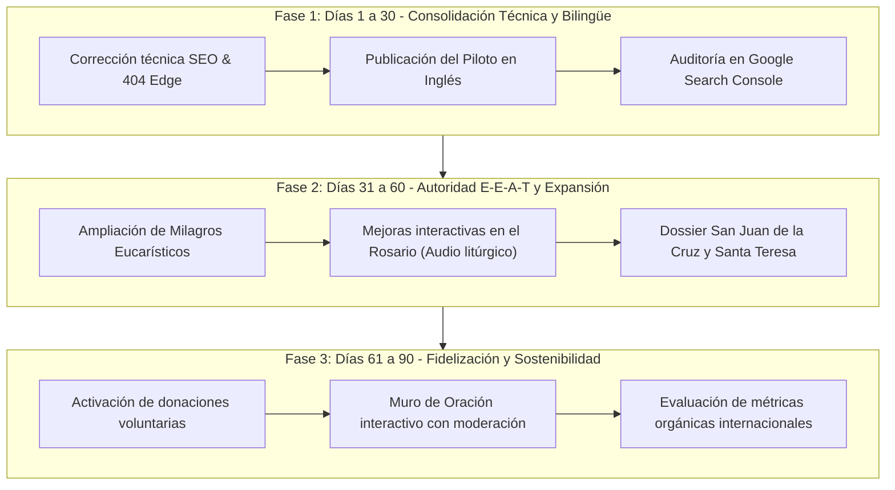

# ESTRATEGIA INTEGRAL Y DIRECCIÓN GENERAL — RAZÓN Y ASOMBRO
**Documento Maestro de Arquitectura, Estrategia Técnica, Crecimiento y Sostenibilidad**  
*Última actualización: 28 de octubre de 2026*  
*Dominio oficial: [https://razonyasombro.com/](https://razonyasombro.com/)*

---

## 1. Resumen Ejecutivo y Rol Asumido

Este documento rige la dirección técnica, editorial y estratégica de **Razón y Asombro** bajo una visión unificada de Dirección General (CTO, Estratega SEO, Arquitecto de Contenido y Responsable de Sostenibilidad).

El proyecto nace para llenar un vacío crítico en el ecosistema digital católico hispano e internacional: la falta de una plataforma que conjugue la **fidelidad incondicional al Magisterio de la Iglesia**, el **rigor científico y forense de fuentes primarias**, una **experiencia de usuario (UX/UI) solemne, rápida y accesible (WCAG 2.1 AA)**, y herramientas interactivas de oración profunda (Santo Rosario PWA, Coronilla de la Divina Misericordia).

El objetivo es convertir a Razón y Asombro en una referencia de consulta y vida de piedad, con arquitectura escalable a costo operativo cero o mínimo, preparada para crecer orgánicamente en Google Search sin comprometer la pureza de su vocación evangelizadora.

---

## 2. Identidad, Propuesta de Valor y Diferenciales

### 2.1 Misión Doctrinal y Editorial
- Proclamar la verdad salvífica de Jesucristo conforme a la Sagrada Escritura (Torres Amat 1825 / Vulgata) y la Sagrada Tradición.
- Explorar los signos tangibles y milagros documentados de la fe mediante peritajes médicos, análisis de laboratorio y fuentes históricas primarias (STURP 1978, WAXS 2022, peritajes histopatológicos de Lanciano y Buenos Aires, Archivos del Santo Oficio sobre San Pío de Pietrelcina).
- Combatir tanto el escepticismo hipercrítico como la credulidad sensacionalista o apócrifa.

### 2.2 Propuesta de Valor Diferencial
A diferencia de agregadores de noticias religiosas o blogs devocionales genéricos:
1. **El Santo Rosario Interactivo (Activo Central de Adquisición y Retención):** Diseñado con visor de cuentas en tiempo real, campanillas litúrgicas sinusoidales (`AudioContext`), vibración háptica, funcionamiento offline (PWA) y soporte bilingüe (Español/Latín e Inglés).
2. **Dossiers Forenses Exhaustivos:** Fichas técnicas auditadas con metodologías de laboratorio, citaciones bibliográficas formales y trazabilidad de custodia de reliquias.
3. **Herramientas de Consuelo y Apologética asistidas por IA en el Edge:** Endpoints en Cloudflare Workers AI (`/api/consuelo`, `/api/apologetica`) respaldados por bases vectoriales y teológicas locales, con tiempos de respuesta subsegundo y costo cero en capa gratuita.

---

## 3. Decisiones Estratégicas de Partida y Justificación

| Decisión Estratégica | Justificación Técnica y Operativa |
| :--- | :--- |
| **1. Español como idioma principal** | Mayor profundidad de catálogo ya existente (30+ artículos) y oportunidad de liderar términos de búsqueda de alta intención en Hispanoamérica y España. |
| **2. Despliegue piloto en inglés (`/en/`)** | Evita dilución de crawl budget y traducciones automáticas de baja calidad. Se inicia con 4 pilares de alto valor: Rosario Interactivo, Guía Paso a Paso, Sábana Santa y Coronilla de la Divina Misericordia. |
| **3. Rosario como motor de recurrencia** | El rezo diario genera sesiones recurrentes, reduce la tasa de rebote a mínimos e impulsa señales de usuario (dwell time, bookmarking, PWA install) favorables para Google E-E-A-T. |
| **4. Modelo de sostenimiento vía donaciones voluntarias** | Preserva la atmósfera contemplativa y la dignidad espiritual. Cero anuncios invasivos o intersticiales durante las fases iniciales. |
| **5. Arquitectura Jamstack estática + Edge Workers** | Astro SSG + Cloudflare Workers Static Assets garantiza puntuaciones Lighthouse cercanas a 100, TTFB ultra bajo en nodos globales y resistencia a picos virales con costo \$0. |

---

## 4. Arquitectura Técnica y Enfoque Multilingüe

### 4.1 Infraestructura
- **Generador de Sitios:** Astro (Modo `output: 'static'`).
- **Motor de Búsqueda Local:** Pagefind (Búsqueda estática indexada en el cliente por idioma `es` y `en`).
- **Plataforma de Despliegue:** Cloudflare Workers con `assets: { directory: "./dist" }` y `wrangler.jsonc`.
- **Enrutamiento de Redirecciones:** `public/_redirects` (301 permanentes para rutas migradas como Padre Pío y `/en/rosary/`).
- **Manejo de Errores 404:** Interceptor en `src/worker.ts` que captura rutas inexistentes en el Edge y retorna código HTTP 404 real junto con el HTML de la plantilla personalizada.

### 4.2 Arquitectura SEO Bilingüe (Hreflang Recíproco)
Cada recurso con versión en inglés cuenta con enlaces canónicos absolutos y cabeceras/etiquetas `<link rel="alternate" hreflang="..." href="..." />` bidireccionales:

```
Página Española ───────────────────────────► Página Inglesa
/                                            /en/
/rosario/                                    /en/interactive-rosary/
/rosario/como-rezar/                         /en/rosary/how-to-pray/
/ciencia-y-fe/sabana-santa-de-turin/         /en/shroud-of-turin/
/santos/faustina-kowalska/                   /en/divine-mercy-chaplet/
```

- **x-default:** Configurado hacia la URL canónica en español correspondiente.
- **Sitemap XML:** `sitemap-index.xml` y `sitemap-0.xml` autogenerados por `@astrojs/sitemap`, excluyendo sistemáticamente redirecciones y páginas de error.

---

## 5. Plan de Acción a 90 Días



### Hitos y Entregables Clave:
- **Día 15:** Verificación en Google Search Console del sitemap, estado de indexación de las 4 rutas inglesas y verificación de no-index en 404.
- **Día 30:** Registro de métricas Core Web Vitals en producción (LCP < 1.5s, CLS < 0.05, INP < 100ms).
- **Día 60:** Incorporación de 6 nuevos dossiers bilingües de alta intención de búsqueda (Lanciano en inglés, San Pío en inglés, Tilma de Guadalupe en inglés).
- **Día 90:** Informe trimestral de tráfico orgánico, retención del Rosario y primeras pruebas de apoyo voluntario de la comunidad.

---

## 6. Hoja de Ruta Editorial y de Producto

### 6.1 Nuevos Artículos y Dossiers Prioritarios (Español e Inglés)
1. **La Tilma del Tepeyac (Nuestra Señora de Guadalupe):** Peritaje oftalmológico del Dr. José Aste Tonsmann (reflejos corneales) y resistencia del tejido de maguey.
2. **Milagro Eucarístico de Lanciano (Italia, siglo VIII):** Análisis anatomopatológico del Dr. Odoardo Linoli (1971) confirmando tejido miocárdico humano con sangre AB.
3. **San Pío de Pietrelcina y los Estigmas:** Análisis de los informes clínicos del Dr. Luigi Romanelli, Dr. Giorgio Festa y los decretos de rehabilitación del Santo Oficio.
4. **Santo Tomás de Aquino y las Cinco Vías:** Síntesis apologética de fides et ratio contra el materialismo contemporáneo.

### 6.2 Evolución de Producto (Rosario & Prayer Tools)
- Soporte para oraciones de audio cantadas en latín gregoriano (archivos comprimidos en WebM/Opus ligeros).
- Modo nocturno de contemplación con reducción total de brillo y contraste suave en tonos ámbar y piedra.
- PWA manifest optimizado con iconos litúrgicos vectoriales y accesos directos de pantalla de inicio para "Rezar Misterios de Hoy".

---

## 7. Estrategia de Monetización y Sostenibilidad

### 7.1 Principios Éticos No Negociables
- **La fe y la oración no son mercancías:** El Santo Rosario, las oraciones bíblicas y el consuelo espiritual serán siempre 100% gratuitos y libres de fricción.
- **Cero rastreadores invasivos:** Ningún script de publicidad programática de baja calidad (AdSense o redes de banners agresivos) que degraden la privacidad del usuario o promuevan contenidos incompatibles con la moral cristiana.

### 7.2 Fases de Monetización:
1. **Fase 1 (Actual - Donaciones Voluntarias):**
   - Habilitación de botón discreto de patrocinio (*"Apoya este apostolado"* / *"Buy Me a Coffee"* / Stripe) en páginas de transparencia y metodología.
   - Mensaje de valor: sostener los costos de dominio, APIs de IA y desarrollo técnico continuo.
2. **Fase 2 (Audiencia Consolidada > 50,000 visitas/mes):**
   - Evaluación exclusiva de patrocinios editoriales éticos directos (editoriales católicas, peregrinaciones solemnes, universidades pontificias).
   - Publicación de libros digitales o guías de oración en formato PDF bellamente maquetadas para descarga libre con opción de donación sugerida.

---

## 8. Matriz de Prioridades Técnicas (P0 a P3)

| Prioridad | Tarea / Requisito | Estado | Criterio de Aceptación |
| :---: | :--- | :---: | :--- |
| **P0** | Corrección de títulos, marcas duplicadas y Schema.org | **COMPLETADO** | Títulos concisos, sufijo unificado, Schema `@graph` válido. |
| **P0** | Redirección 301 de la ruta huérfana del Padre Pío | **COMPLETADO** | Retorna 301 a `/padre-pio/estudios-medicos-y-santo-oficio/`. |
| **P0** | Configuración de Edge 404 real en Cloudflare Workers | **COMPLETADO** | Código HTTP 404 con entrega del HTML de plantilla. |
| **P1** | Piloto Internacional en Inglés (`/en/`) con 4 páginas core | **COMPLETADO** | Home, Rosario, Guía How-to, Sábana Santa y Coronilla. |
| **P1** | Etiquetas `hreflang` recíprocas en páginas bilingües | **COMPLETADO** | Enlaces bidireccionales `es`, `en` y `x-default` en `<head>`. |
| **P1** | Selector de idioma (Language Switcher) accesible | **COMPLETADO** | Toggle `ES \| EN` en Header de escritorio y móvil. |
| **P2** | Sincronización e inspección en Google Search Console | **PENDIENTE** | Subida manual del sitemap e inspección de URLs. |
| **P2** | Medición de Core Web Vitals en campo (RUM) | **EN CURSO** | Monitoreo con Cloudflare Web Analytics y Search Console. |
| **P3** | Traducción progresiva de dossiers de Milagros Eucarísticos | **PROGRAMADO** | Lanciano y Buenos Aires en `/en/` para Q1 2027. |

---

## 9. Bitácora de Cambios Técnicos y Estratégicos

### Versión 1.2 (28 de octubre de 2026)
- **Implementación del Piloto en Inglés (`/en/`):**
  - Creada página de inicio internacional [`src/pages/en/index.astro`](file:///c:/Users/Ryzen%205/Desktop/Pagina%20catolica/src/pages/en/index.astro).
  - Creada página del Rosario interactivo [`src/pages/en/interactive-rosary.astro`](file:///c:/Users/Ryzen%205/Desktop/Pagina%20catolica/src/pages/en/interactive-rosary.astro).
  - Creada guía de rezo paso a paso [`src/pages/en/rosary/how-to-pray.astro`](file:///c:/Users/Ryzen%205/Desktop/Pagina%20catolica/src/pages/en/rosary/how-to-pray.astro) con `HowTo` Schema.
  - Creado dossier científico de la Sábana Santa [`src/pages/en/shroud-of-turin.astro`](file:///c:/Users/Ryzen%205/Desktop/Pagina%20catolica/src/pages/en/shroud-of-turin.astro) con `Article` Schema.
  - Creada guía teológica de la Coronilla [`src/pages/en/divine-mercy-chaplet.astro`](file:///c:/Users/Ryzen%205/Desktop/Pagina%20catolica/src/pages/en/divine-mercy-chaplet.astro).
- **Enrutamiento y Redirecciones:**
  - Redirección 301 de `/en/rosary` y `/en/rosary/` hacia `/en/interactive-rosary/` en `astro.config.mjs` y `public/_redirects`.
- **Componentes Globales Bilingües:**
  - Modificado [`src/components/global/BaseHead.astro`](file:///c:/Users/Ryzen%205/Desktop/Pagina%20catolica/src/components/global/BaseHead.astro) para soportar etiquetas `hreflang` y locales dinámicos.
  - Modificado [`src/layouts/BaseLayout.astro`](file:///c:/Users/Ryzen%205/Desktop/Pagina%20catolica/src/layouts/BaseLayout.astro) con atributo `lang` en `<html>` y salto accesible bilingüe.
  - Modificado [`src/components/global/Header.astro`](file:///c:/Users/Ryzen%205/Desktop/Pagina%20catolica/src/components/global/Header.astro) con selector de idioma `ES | EN` y navegación contextual.
  - Modificado [`src/components/global/Footer.astro`](file:///c:/Users/Ryzen%205/Desktop/Pagina%20catolica/src/components/global/Footer.astro) con textos y enlaces localizados.
  - Actualizados [`src/layouts/ArticleLayout.astro`](file:///c:/Users/Ryzen%205/Desktop/Pagina%20catolica/src/layouts/ArticleLayout.astro) y [`src/layouts/FactLayout.astro`](file:///c:/Users/Ryzen%205/Desktop/Pagina%20catolica/src/layouts/FactLayout.astro).

### Versión 1.1 (28 de octubre de 2026)
- **Correcciones de SEO Técnico y Magisterio:**
  - Eliminado sufijo de título duplicado en portada y artículos.
  - Corregido pie de página: reemplazado "Agnóstico y Local" por "Fidelidad al Magisterio".
  - Corregida atribución editorial: reemplazada comisión inexistente por "Revisión Editorial Interna".
  - Configurado enrutador de Edge en Cloudflare Workers para entregar status 404 real en rutas no encontradas.
  - Añadida redirección permanente para `/santos/estudios-medicos-y-santo-oficio/`.
