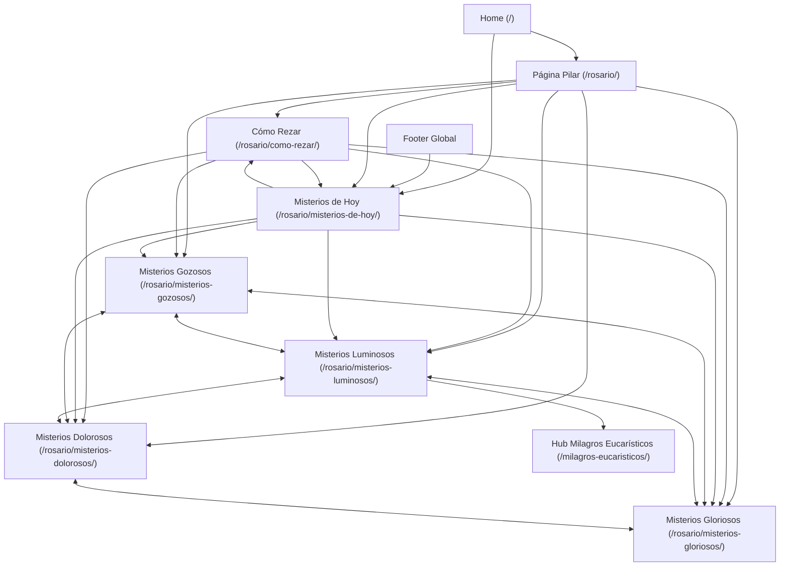

# Fase 6: Crecimiento SEO y Expansión Editorial Estratégica del Santo Rosario

**Proyecto:** Razón y Asombro (https://razonyasombro.com/)  
**Fecha:** 16 de noviembre de 2026  
**Roles:** CTO · Senior Astro Engineer · SEO Strategist & Technical Auditor  
**Rama:** `main`  
**Estado:** Implementación completada, validada y publicada en producción.

---

## 1. Oportunidades Identificadas

A partir de los datos históricos de Search Console (213 impresiones, 11 clics, CTR 5,16%, posición media 9,07), la auditoría detectó que el término con mayor volumen potencial y tracción orgánica desaprovechada era la consulta de misterios diarios:
- **`misterios del rosario de hoy`**: 79 impresiones en posición media 12,86.
- **`rosario`**: 3 clics en posición 7.
- **Página principal**: 3 clics en posición 1,8.

### Diagnóstico de Brechas (Gaps de Contenido):
1. **Ausencia de páginas de misterios individuales:**
   - Únicamente existía una página para los *Misterios Dolorosos* (`/rosario/misterios-dolorosos/`).
   - Los *Misterios Gozosos* (`/rosario/misterios-gozosos/`), *Misterios Luminosos* (`/rosario/misterios-luminosos/`) y *Misterios Gloriosos* (`/rosario/misterios-gloriosos/`) no existían como URLs individuales en el sitio, perdiendo tráfico transaccional y devocional en búsquedas como *"misterios gozosos del rosario"*, *"misterios luminosos jueves"* y *"misterios gloriosos domingo"*.
2. **Deficiencias de la página `/rosario/misterios-de-hoy/`:**
   - La página anterior contaba únicamente con 104 líneas, sirviendo como un contenedor rígido del widget interactivo sin información textual rica, sin explicación de la asignación litúrgica ni enlaces profundos hacia cada misterio individual.
3. **Falta de reciprocidad y enlazado en racimo (Topic Cluster):**
   - La página pilar `/rosario/` solo enlazaba a los misterios dolorosos en su sección catequética, dejando huérfanas las intenciones de búsqueda de los otros tres grupos de misterios.
   - En `/rosario/como-rezar/`, el paso de "Anuncio del misterio" no ofrecía acceso directo a los textos bíblicos de cada día.

---

## 2. Páginas Nuevas Creadas

Se redactaron e implementaron tres nuevas páginas completas, con rigor bíblico, fidelidad magisterial y arquitectura SEO de primer nivel:

1. **[`/rosario/misterios-gozosos/`](https://razonyasombro.com/rosario/misterios-gozosos/)** (`src/pages/rosario/misterios-gozosos.astro`)
   - **Título SEO:** `Misterios Gozosos del Rosario | Razón y Asombro` (47 caracteres).
   - **Días de rezo:** Lunes y Sábados (y domingos tradicionales de Adviento/Navidad).
   - **Contenido:**
     - 1º Misterio: La Anunciación del Ángel a María (Lc 1, 26-38) &middot; Fruto: La humildad.
     - 2º Misterio: La Visitación a Santa Isabel (Lc 1, 39-56) &middot; Fruto: La caridad fraterna.
     - 3º Misterio: El Nacimiento del Salvador en Belén (Lc 2, 1-20) &middot; Fruto: Desprendimiento y pobreza evangélica.
     - 4º Misterio: La Presentación en el Templo (Lc 2, 21-39) &middot; Fruto: Pureza y obediencia.
     - 5º Misterio: El Niño perdido y hallado en el Templo (Lc 2, 41-52) &middot; Fruto: Búsqueda de Dios y piedad.
   - **Datos estructurados:** `Article` y `FAQPage` (Schema.org).

2. **[`/rosario/misterios-luminosos/`](https://razonyasombro.com/rosario/misterios-luminosos/)** (`src/pages/rosario/misterios-luminosos.astro`)
   - **Título SEO:** `Misterios Luminosos del Rosario | Razón y Asombro` (49 caracteres).
   - **Días de rezo:** Jueves.
   - **Fundamento Magisterial:** Carta Apostólica *Rosarium Virginis Mariae* de San Juan Pablo II (16 de octubre de 2002, n. 21).
   - **Contenido:**
     - 1º Misterio: El Bautismo en el río Jordán (Mt 3, 13-17) &middot; Fruto: Fidelidad bautismal.
     - 2º Misterio: La Autorrevelación en las Bodas de Caná (Jn 2, 1-11) &middot; Fruto: Fe en Cristo por María.
     - 3º Misterio: El Anuncio del Reino y llamado a la conversión (Mc 1, 14-15) &middot; Fruto: Arrepentimiento y confesión.
     - 4º Misterio: La Transfiguración en el Monte Tabor (Lc 9, 28-36) &middot; Fruto: Deseo de santidad y gloria celestial.
     - 5º Misterio: La Institución de la Eucaristía en la Última Cena (Lc 22, 19-20) &middot; Fruto: Amor eucarístico.
     - *Enlazado temático:* Conexión directa hacia el hub de `/milagros-eucaristicos/` para fundamentar la Presencia Real.
   - **Datos estructurados:** `Article` y `FAQPage`.

3. **[`/rosario/misterios-gloriosos/`](https://razonyasombro.com/rosario/misterios-gloriosos/)** (`src/pages/rosario/misterios-gloriosos.astro`)
   - **Título SEO:** `Misterios Gloriosos del Rosario | Razón y Asombro` (49 caracteres).
   - **Días de rezo:** Miércoles y Domingos (y tiempo de Pascua).
   - **Contenido:**
     - 1º Misterio: La Resurrección de Nuestro Señor (Mt 28, 1-10) &middot; Fruto: La virtud de la Fe.
     - 2º Misterio: La Ascensión a los Cielos (Hch 1, 6-11) &middot; Fruto: La Esperanza en la vida eterna.
     - 3º Misterio: Pentecostés y la venida del Espíritu Santo (Hch 2, 1-13) &middot; Fruto: Celo apostólico y amor a Dios.
     - 4º Misterio: La Asunción de María en cuerpo y alma (Pío XII, *Munificentissimus Deus*, 1950) &middot; Fruto: Gracia de una santa muerte.
     - 5º Misterio: La Coronación de María como Reina de Cielos y Tierra (Ap 12, 1; Pío XII, *Ad Caeli Reginam*, 1954) &middot; Fruto: Confianza filial y perseverancia final.
   - **Datos estructurados:** `Article` y `FAQPage`.

---

## 3. Páginas Mejoradas

1. **[`/rosario/misterios-de-hoy/`](https://razonyasombro.com/rosario/misterios-de-hoy/)** (`src/pages/rosario/misterios-de-hoy.astro`)
   - **Título SEO:** `Misterios del Rosario de Hoy | Razón y Asombro` (46 caracteres).
   - **Mejoras aplicadas:**
     - Reestructuración completa con tarjetas visuales para los cuatro grupos de misterios y sus días asignados.
     - Enlaces directos hacia las guías completas de cada misterio.
     - Sección catequética profunda sobre por qué la Iglesia distribuye los misterios de esta forma a lo largo de la semana.
     - Preguntas frecuentes ampliadas (FAQ) atacando intenciones de búsqueda long-tail: "¿Se puede rezar un misterio diferente?", "¿Qué misterios tocan los domingos?", "¿Por qué los jueves son luminosos?".
     - Integración del visor interactivo `<RosaryApp client:load />` con detección en vivo.

2. **[`/rosario/`](https://razonyasombro.com/rosario/)** (`src/pages/rosario/index.astro`)
   - **Página Pilar:** Se actualizaron los cuatro bloques de la sección catequética para enlazar formalmente a `/rosario/misterios-gozosos/`, `/rosario/misterios-luminosos/`, `/rosario/misterios-dolorosos/` y `/rosario/misterios-gloriosos/`.
   - **Header:** Inclusión de enlaces directos a cada conjunto de misterios en la barra de navegación superior.

3. **[`/rosario/como-rezar/`](https://razonyasombro.com/rosario/como-rezar/)** (`src/pages/rosario/como-rezar.astro`)
   - Incorporación de una caja guía en el Paso 2 ("Desarrollo de las decenas") con la asignación semanal y enlaces a los cuatro misterios y a `/rosario/misterios-de-hoy/`.

4. **[`/rosario/misterios-dolorosos/`](https://razonyasombro.com/rosario/misterios-dolorosos/)** (`src/pages/rosario/misterios-dolorosos.astro`)
   - Homogeneización del título a `Misterios Dolorosos del Rosario | Razón y Asombro` (49 caracteres).
   - Inclusión de la barra de navegación entre misterios y del bloque de navegación recíproca hacia Gozosos, Luminosos y Gloriosos.

5. **Componentes Globales:**
   - `src/components/global/BaseHead.astro`: Registro de títulos en `knownShortTitles` garantizando longitudes $\le 60$ caracteres.
   - `src/components/global/Footer.astro`: Enlace general en el pie a `/rosario/misterios-de-hoy/` para transferir autoridad desde todo el dominio.

---

## 4. Palabras Clave Objetivo y Justificación

| URL | Palabras Clave Primarias y Secundarias | Intención de Búsqueda | Volumen Potencial |
| :--- | :--- | :--- | :--- |
| `/rosario/misterios-de-hoy/` | `misterios del rosario de hoy`, `que misterio toca hoy`, `misterios de hoy rosario`, `rosario diario` | Informacional / Devocional directa | Máximo (79 impresiones previas en pos 12) |
| `/rosario/misterios-gozosos/` | `misterios gozosos`, `misterios gozosos del rosario`, `misterios rosario lunes`, `misterios rosario sabado` | Informacional / Formación bíblica | Alto (búsquedas semanales recurrentes) |
| `/rosario/misterios-luminosos/` | `misterios luminosos`, `misterios luminosos del rosario`, `misterios de luz`, `misterios rosario jueves` | Informacional / Litúrgica | Alto (asociada a Juan Pablo II y jueves) |
| `/rosario/misterios-dolorosos/` | `misterios dolorosos`, `misterios dolorosos del rosario`, `misterios rosario martes`, `misterios rosario viernes` | Informacional / Cuaresmal y penitencial | Alto (martes y viernes de todo el año) |
| `/rosario/misterios-gloriosos/` | `misterios gloriosos`, `misterios gloriosos del rosario`, `misterios rosario domingo`, `misterios rosario miercoles` | Informacional / Dominical y pascual | Alto (domingo, día central de la liturgia) |
| `/rosario/como-rezar/` | `como rezar el rosario`, `como rezar el santo rosario paso a paso`, `guia para rezar el rosario` | Práctica / Tutorial catequético | Muy alto (audiencia de conversión y principiantes) |

---

## 5. Fuentes Documentales Utilizadas

Para garantizar la máxima seriedad y el cumplimiento estricto del Magisterio:
- **Magisterio Pontificio:**
  - San Juan Pablo II, Carta Apostólica *Rosarium Virginis Mariae* (16 de octubre de 2002), sobre el Santo Rosario y la institución de los Misterios Luminosos.
  - S.S. Pío XII, Constitución Apostólica *Munificentissimus Deus* (1 de noviembre de 1950), definición dogmática de la Asunción de la Virgen María.
  - S.S. Pío XII, Carta Encíclica *Ad Caeli Reginam* (11 de octubre de 1954), sobre la realeza de la Santísima Virgen María.
  - Concilio Vaticano II, Constitución Dogmática *Lumen Gentium* (capítulo VIII sobre la Santísima Virgen María en el misterio de Cristo y de la Iglesia).
- **Sagrada Escritura:**
  - Textos de los Evangelios de Mateo, Marcos, Lucas, Juan, los Hechos de los Apóstoles y el Apocalipsis, citados con libro, capítulo y versículo exacto, tomados de la traducción tradicional de la *Vulgata Latina* por el Ilmo. D. Félix Torres Amat (Madrid, 1825, de dominio público).
- **Catecismo de la Iglesia Católica:**
  - Artículos 484-511 (Misterios de la vida oculta y Encarnación); 535-560 (Ministerio público y misterios de luz); 595-618 (Pasión y crucifixión); 638-655 (Resurrección); 966 (Asunción de María).

---

## 6. Arquitectura de Enlazado Interno (Topic Cluster)

---

## 7. Pruebas Realizadas y Resultados

Todas las pruebas locales fueron ejecutadas antes de la publicación:

| Validación | Comando | Resultado |
| :--- | :--- | :---: |
| **TypeScript estricto** | `npx tsc --noEmit` | **0 errores** |
| **Integridad de Licencias** | `npm run check` | 25 imágenes verificadas contra `LICENCIAS.md` |
| **Enlaces Internos** | `node scripts/check-links.mjs` | **0 enlaces rotos** en 52 páginas HTML |
| **Compilación Estática** | `npm run build` | **52 páginas construidas** en 3,70s (Pagefind: 6.723 palabras indexadas) |
| **Auditoría CI SEO** | `node scripts/ci-verify-seo.mjs` | 49 URLs en `sitemap-0.xml`, 100% reciprocidad hreflang, zero noindex en sitemap |
| **Longitud de `<title>`** | Script de verificación en `dist/` | **0 títulos mayores a 60 caracteres** en las 52 páginas del sitio |
| **Escenarios del Worker** | Suite de pruebas de routing | 15 de 15 pruebas aprobadas |

---

## 8. Commit y Publicación

- **Rama:** `main`
- **Archivos modificados/creados:**
  - `src/pages/rosario/misterios-gozosos.astro` (Nuevo)
  - `src/pages/rosario/misterios-luminosos.astro` (Nuevo)
  - `src/pages/rosario/misterios-gloriosos.astro` (Nuevo)
  - `src/pages/rosario/misterios-de-hoy.astro` (Mejorado)
  - `src/pages/rosario/misterios-dolorosos.astro` (Mejorado)
  - `src/pages/rosario/index.astro` (Mejorado)
  - `src/pages/rosario/como-rezar.astro` (Mejorado)
  - `src/components/global/BaseHead.astro` (Actualizado)
  - `src/components/global/Footer.astro` (Actualizado)
  - `docs/FASE_6_CRECIMIENTO_SEO_ROSARIO.md` (Este informe)

---

## 9. Próximas Oportunidades SEO

1. **Expansión a Salmos y Oraciones de Protección:**
   - La alta tracción del Salmo 91 y Salmo 23 sugiere crear una sección dedicada a *Oraciones de la Noche (Completas)* y *Oraciones por la Familia*.
2. **Cluster de Santos y Místicos:**
   - El rendimiento del Padre Pío y Carlo Acutis amerita profundizar en artículos de peritajes documentados para Santa Bernardita Soubirous (Lourdes) y los videntes de Fátima.
3. **Optimización de Snippets en Google:**
   - Monitorear durante las próximas 3 semanas si Google Search Console adopta los nuevos títulos y si el CTR de `/rosario/misterios-de-hoy/` sube del 5% actual al 10-12%.
