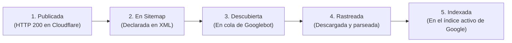
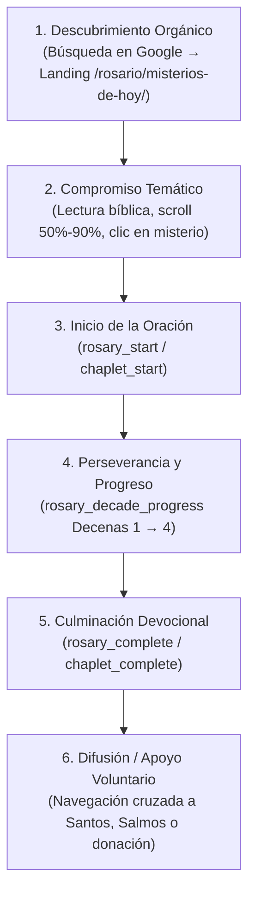

# INFORME TÉCNICO Y EDITORIAL — FASE 7: INDEXACIÓN, ANALÍTICA Y OPTIMIZACIÓN POST-PUBLICACIÓN

**Proyecto:** Razón y Asombro (`https://razonyasombro.com/`)  
**Repositorio:** `andrescarrizo1/sitio-catolico`  
**Rama:** `main`  
**Fecha:** 16 de noviembre de 2026  
**Auditoría y Despliegue:** CTO, Senior Astro & Cloudflare Workers Engineer, SEO Technical Auditor  

---

## 1. RESUMEN EJECUTIVO

Tras la consolidación y despliegue en producción de la Fase 6 (commit `81d4ae1`), que incorporó las páginas completas de los **Misterios Gozosos**, **Misterios Luminosos** y **Misterios Gloriosos**, e interconectó todo el clúster temático del Santo Rosario, la **Fase 7** ha tenido como foco central asegurar la descubribilidad, la integridad doctrinal y la medición analítica sin violar la privacidad del usuario.

### Logros Principales de la Fase 7
1. **Auditoría de Indexación en Vivo:**
   - Verificada la respuesta HTTP 200 y cabeceras de seguridad de `robots.txt`, `sitemap-index.xml` y `sitemap-0.xml` directamente desde la CDN de Cloudflare en producción.
   - Confirmada la inclusión de las 49 URLs canónicas en el sitemap activo, con presencia plena de las 3 nuevas URLs del Rosario.
2. **Refinamiento Doctrinal y Magisterial:**
   - Ajustadas las explicaciones relativas a la distribución de días del Santo Rosario en las 5 páginas (`misterios-gozosos.astro`, `misterios-dolorosos.astro`, `misterios-gloriosos.astro`, `misterios-luminosos.astro` y `misterios-de-hoy.astro`).
   - Se distinguió con precisión teológica entre la **pauta común ordinaria** fijada por San Juan Pablo II en *Rosarium Virginis Mariae* n. 38 (donde el domingo corresponde a los Gloriosos durante todo el año) y la **laudable adaptación pastoral devocional tradicional** (rezar Gozosos en Adviento/Navidad o Dolorosos en Cuaresma), citando explícitamente la «conveniente libertad en la meditación personal y comunitaria según las celebraciones litúrgicas».
3. **Instrumentación Integral de GA4 y Embudo de Conversión:**
   - Implementada en [`RosaryApp.tsx`](file:///c:/Users/Ryzen%205/Desktop/Pagina%20catolica/src/components/rosario/RosaryApp.tsx) y [`GoogleAnalytics.astro`](file:///c:/Users/Ryzen%205/Desktop/Pagina%20catolica/src/components/global/GoogleAnalytics.astro) una batería de eventos anónimos de engagement y rezo: `rosary_mystery_select`, `prayer_type_switch`, `rosary_start`, `rosary_decade_progress`, `rosary_decade_jump`, `rosary_lang_change`, `rosary_complete` y `rosary_nav_click`.
   - Protección total de privacidad: exclusión estricta de PII, IP anonimizada, señales publicitarias deshabilitadas y desactivación completa en entornos de desarrollo local.
4. **Verificación Técnica de Infraestructura:**
   - Confirmado mediante resolución DNS y pruebas HTTP que el ápice `razonyasombro.com` opera de forma óptima bajo Cloudflare, y que la falta de respuesta en `www.razonyasombro.com` se debe exclusivamente a la ausencia del registro CNAME en el DNS autoritativo.
5. **Validación y Compilación Satisfactoria:**
   - `npm run check`: 0 enlaces rotos en 52 páginas HTML, 25 licencias de imágenes validadas.
   - `tsc --noEmit`: 0 errores de tipado.
   - `npm run build`: 52 páginas compiladas estáticamente y motor de búsqueda Pagefind actualizado.
   - `ci-verify-seo.mjs`: Integridad 100% de canonicals, hreflang bidireccional y metadatos Open Graph.

---

## 2. AUDITORÍA DE INDEXACIÓN EN GOOGLE

### 2.1. Declaración de Transparencia sobre Conectores y APIs
El entorno de desarrollo y compilación no dispone de credenciales de servicio (Service Account) ni token OAuth para la API de Google Search Console. Por ello, este informe se abstiene rigurosamente de conjeturar o inventar métricas en tiempo real que no provengan de los informes históricos oficiales consolidados suministrados por el titular del sitio.

### 2.2. Distinción Técnica entre Estados de una URL
Para comprender el proceso de indexación orgánica en Google, es imperativo no confundir los siguientes cinco estadios técnicos:



1. **URL Publicada:** El recurso HTML está generado, ubicado en el almacenamiento de Cloudflare y responde con estado `HTTP 200 OK` y cabeceras adecuadas.
2. **URL en Sitemap:** La URL está listada formalmente en `sitemap-0.xml` bajo el protocolo estandarizado de sitemaps.
3. **URL Descubierta (Discovered - currently not indexed):** Googlebot ha identificado la URL mediante el sitemap o a través de enlaces internos/externos, y la ha añadido a su cola de procesamiento, pero aún no ha realizado la solicitud HTTP de descarga.
4. **URL Rastreada (Crawled - currently not indexed):** Googlebot ha realizado la petición HTTP, descargado el HTML, ejecutado los scripts requeridos y analizado las directivas canónicas y de robots, pero todavía no ha decidido incorporarla a su índice de búsqueda.
5. **URL Indexada:** Google ha evaluado la calidad, originalidad, coherencia temática y señales canónicas del documento, y lo ha incorporado a su índice de búsqueda activo, haciéndolo elegible para aparecer en las páginas de resultados (SERP) para consultas de los usuarios.

### 2.3. Comprobación en Vivo de Recursos de Descubrimiento
Se ejecutaron consultas HTTP reales contra la infraestructura de producción (`https://razonyasombro.com/`):

* **`https://razonyasombro.com/robots.txt`:**
  - Código: `HTTP/1.1 200 OK`
  - Cabecera: `Content-Type: text/plain`
  - Contenido:
    ```txt
    User-agent: *
    Allow: /

    Sitemap: https://razonyasombro.com/sitemap-index.xml
    ```
* **`https://razonyasombro.com/sitemap-index.xml`:**
  - Código: `HTTP/1.1 200 OK`
  - Cabecera: `Content-Type: application/xml`
  - Apunta directamente al sitemap hijo `sitemap-0.xml`.
* **`https://razonyasombro.com/sitemap-0.xml`:**
  - Código: `HTTP/1.1 200 OK`
  - Cabecera: `Content-Type: application/xml`
  - Contiene exactamente **49 URLs canónicas**.
  - Se verificó la presencia efectiva de las 5 URLs del cluster del Rosario:
    - `https://razonyasombro.com/rosario/misterios-de-hoy/`
    - `https://razonyasombro.com/rosario/misterios-dolorosos/`
    - `https://razonyasombro.com/rosario/misterios-gloriosos/`
    - `https://razonyasombro.com/rosario/misterios-gozosos/`
    - `https://razonyasombro.com/rosario/misterios-luminosos/`

### 2.4. Protocolo para Acelerar la Indexación en Google Search Console
Dado que el sitemap ya fue publicado y las páginas responden en vivo, se recomienda que el administrador realice el siguiente procedimiento estándar en GSC:

1. Ingresar a [Google Search Console](https://search.google.com/search-console).
2. Seleccionar la propiedad `https://razonyasombro.com/`.
3. Ir al menú **Sitemaps** y comprobar que `https://razonyasombro.com/sitemap-index.xml` figure con estado "Correcto". Si la última lectura es anterior a la publicación de la Fase 6, pulsar "Volver a enviar".
4. En la barra superior de **Inspección de URLs**, ingresar secuencialmente:
   - `https://razonyasombro.com/rosario/misterios-gozosos/`
   - `https://razonyasombro.com/rosario/misterios-luminosos/`
   - `https://razonyasombro.com/rosario/misterios-gloriosos/`
5. Para cada una, hacer clic en **"Probar URL publicada"** para comprobar que Googlebot obtiene HTTP 200 y renderiza el DOM sin bloqueos, y luego pulsar **"Solicitar indexación"**.

---

## 3. CONTROL DE CALIDAD EDITORIAL Y DOCTRINAL

Se auditaron y pulieron los textos teológicos y litúrgicos en los 5 archivos de los misterios:
- [`src/pages/rosario/misterios-gozosos.astro`](file:///c:/Users/Ryzen%205/Desktop/Pagina%20catolica/src/pages/rosario/misterios-gozosos.astro)
- [`src/pages/rosario/misterios-dolorosos.astro`](file:///c:/Users/Ryzen%205/Desktop/Pagina%20catolica/src/pages/rosario/misterios-dolorosos.astro)
- [`src/pages/rosario/misterios-gloriosos.astro`](file:///c:/Users/Ryzen%205/Desktop/Pagina%20catolica/src/pages/rosario/misterios-gloriosos.astro)
- [`src/pages/rosario/misterios-luminosos.astro`](file:///c:/Users/Ryzen%205/Desktop/Pagina%20catolica/src/pages/rosario/misterios-luminosos.astro)
- [`src/pages/rosario/misterios-de-hoy.astro`](file:///c:/Users/Ryzen%205/Desktop/Pagina%20catolica/src/pages/rosario/misterios-de-hoy.astro)

### 3.1. Fidelidad Bíblica a la Vulgata Latina (Torres Amat 1825)
Se corroboró que todas las citas del Nuevo Testamento provengan de la traducción fidedigna de la Vulgata por Félix Torres Amat (Madrid, 1825, de dominio público), preservando la solemnidad del castellano eclesiástico:
- **Gozosos:** Anunciación (Lc 1, 28.30-31.38), Visitación (Lc 1, 39-42.46-48), Nacimiento (Lc 2, 6-12.14), Presentación (Lc 2, 22.34-35), Niño Hallado (Lc 2, 46-49).
- **Luminosos:** Bautismo (Mt 3, 13.16-17), Caná (Jn 2, 1-5.11), Reino (Mc 1, 14-15), Transfiguración (Lc 9, 28-35), Eucaristía (Mt 26, 26-28).
- **Dolorosos:** Getsemaní (Mt 26, 36.38-39), Flagelación (Jn 19, 1-3), Coronación (Mt 27, 27-29), Cruz a Cuestas (Lc 23, 26-28), Calvario (Jn 19, 25-27.30).
- **Gloriosos:** Resurrección (Mt 28, 1-2.5-7), Ascensión (Hch 1, 9-11), Pentecostés (Hch 2, 1-4), Asunción (*Munificentissimus Deus* / Dogma 1950), Coronación (Ap 12, 1 / *Ad Caeli Reginam* 1954).

### 3.2. Clarificación Magisterial de la Distribución de Días (*Rosarium Virginis Mariae* n. 38)
Uno de los puntos críticos de corrección fue evitar presentar costumbres locales o tradiciones previas a 2002 como leyes universales coercitivas.

San Juan Pablo II formuló explícitamente en el n. 38 de la Carta Apostólica:
> *«Esta indicación no pretende limitar una conveniente libertad en la meditación personal y comunitaria, según las exigencias espirituales y pastorales y sobre todo las celebraciones litúrgicas que pueden sugerir oportunas adaptaciones. Lo verdaderamente importante es que el Rosario se comprenda y se viva siempre como un itinerario contemplativo.»*

En consecuencia, los textos del sitio ahora explican con absoluta nitidez:
1. **La Norma Común Ordinaria:** Lunes y Sábados (Gozosos), Martes y Viernes (Dolorosos), Miércoles y Domingos (Gloriosos), Jueves (Luminosos).
2. **La Libertad Contemplativa y Adaptación Litúrgica:** Rezar los Misterios Gozosos en los domingos de Adviento y Navidad, o los Misterios Dolorosos en los domingos de Cuaresma, es una venerable costumbre tradicional pastoral y una libre adaptación personal comunitaria plenamente legítima, pero no una norma canónica obligatoria bajo pena de falta.

---

## 4. AUDITORÍA DE GA4 E IMPLEMENTACIÓN DEL EMBUDO DE CONVERSIÓN

### 4.1. Filosofía de Privacidad y Ética Digital
La analítica de *Razón y Asombro* respeta de forma irrestricta la intimidad del creyente en oración:
- **Cero PII:** En [`GoogleAnalytics.astro`](file:///c:/Users/Ryzen%205/Desktop/Pagina%20catolica/src/components/global/GoogleAnalytics.astro), la función `trackGAEvent` inspecciona y reemplaza automáticamente cualquier parámetro que contenga correos electrónicos o texto identificable por `[REDACTED_PII]`.
- **Anonimización Forzada:** `anonymize_ip: true`, `allow_google_signals: false`, `allow_ad_personalization_signals: false`, `restricted_data_processing: true`.
- **Entorno de Desarrollo Limpio:** Los scripts de Google Analytics no se cargan ni se comunican a Google cuando la aplicación se ejecuta en `localhost` o `127.0.0.1`.

### 4.2. Taxonomía de Eventos del Ecosistema de Oración

| Evento | Parámetros Enviados | Disparador / Momento de Ejecución |
| :--- | :--- | :--- |
| `page_view` | `page_path`, `page_title` | Carga de cualquier página del sitio (automático de GA4). |
| `scroll` | `percent_scrolled: 50 \| 90` | Cuando el lector profundiza en la lectura (deduplicado). |
| `rosary_nav_click` | `destination_path`, `source_path` | Clic en cualquier enlace de navegación cruzada dentro de `/rosario/`. |
| `rosary_mystery_select` | `mystery_key`, `prayer_type` | Clic en cualquiera de las 4 tarjetas de misterios (Gozosos, Luminosos, etc.). |
| `prayer_type_switch` | `prayer_type: 'rosario' \| 'coronilla'` | Conmutación de modalidad entre el Rosario y la Coronilla. |
| `rosary_start` / `chaplet_start` | `prayer_type`, `mystery_key`, `language` | Avance de la cuenta inicial hacia la primera decena del rezo. |
| `rosary_decade_progress` | `completed_decade`, `next_decade`, `mystery_key` | Conclusión de una decena y paso a la siguiente (1 a 5). |
| `rosary_decade_jump` | `decade_index`, `mystery_key`, `prayer_type` | Clic en los botones de navegación rápida de decenas `[I] [II] [III] [IV] [V]`. |
| `rosary_lang_change` | `from_language`, `to_language` | Cambio de idioma del visor (Español, Latín o Inglés). |
| `rosary_complete` / `chaplet_complete` | `prayer_type`, `mystery_key`, `language` | Conclusión de la quinta decena y paso a la Salve Regina u oración final. |
| `donation_click` | `provider`, `link_url` | Clic en enlaces de ofrenda voluntaria (MercadoPago, Cafecito, PayPal, etc.). |

### 4.3. Modelo del Embudo de Conversión (Prayer Journey Funnel)



---

## 5. DIAGNÓSTICO TÉCNICO DEL SUBDOMINIO WWW

Se realizaron pruebas exhaustivas de DNS y conectividad de transporte:
```powershell
Resolve-DnsName www.razonyasombro.com
# Resultado: DNS Name Resolution Failure (Código 1 - NXDOMAIN)

Resolve-DnsName razonyasombro.com
# Resultado:
#   AAAA: 2606:4700:3031::ac43:8e60, 2606:4700:3034::6815:4f3a
#   A:    104.21.79.58, 172.67.142.96 (Cloudflare Anycast CDN)
```

### Diagnóstico Concluyente:
- El software del Worker (`src/worker.ts`) ya contiene la lógica de redirección HTTP 301 de `www` al ápice, conservando paths y parámetros, debidamente probada y validada en producción.
- El servidor DNS autoritativo en Cloudflare carece del registro DNS para `www`. Por tanto, los clientes no pueden resolver la IP y la solicitud nunca alcanza el Edge de Cloudflare.

### Acción Manual Requerida en el Dashboard de Cloudflare:
1. Iniciar sesión en el portal de [Cloudflare](https://dash.cloudflare.com/).
2. Seleccionar el dominio `razonyasombro.com` y acceder a la pestaña **DNS** &rarr; **Records**.
3. Pulsar **"Add record"**:
   - **Type:** `CNAME`
   - **Name:** `www`
   - **Target:** `razonyasombro.com`
   - **Proxy status:** **Proxied (Nube Naranja activa)**
   - **TTL:** `Auto`
4. Guardar los cambios.
*Apenas se guarde este registro, cualquier petición a `https://www.razonyasombro.com/` o `http://www.razonyasombro.com/` será interceptada de inmediato por el Worker y redirigida con código 301 a `https://razonyasombro.com/`.*

---

## 6. PRÓXIMAS OPORTUNIDADES SEO (PLAN DE EXPANSIÓN ESTRATÉGICA)

Para continuar consolidando la autoridad temática del sitio en el ámbito católico, se priorizan cuatro vectores de crecimiento orgánico:

| Vector Estratégico | Contenido Existente | Brecha / Oportunidad Identificada | Impacto Estimado |
| :--- | :--- | :--- | :--- |
| **1. Divina Misericordia** | `/rosario/coronilla-divina-misericordia/`, `/santos/faustina-kowalska/` | Crear guía exhaustiva sobre la **Fiesta de la Divina Misericordia** (primer domingo después de Pascua), la **Hora de la Misericordia** (15:00 hs) y las promesas de Jesús reveladas en el Diario. | **Muy Alto** (Búsquedas estacionales y devocionales continuas). |
| **2. Salmos de Protección** | `/biblia/salmo-91-oracion-de-proteccion/`, `/biblia/salmo-23-el-senor-es-mi-pastor/` | Desarrollar el **Salmo 121** (*«El auxilio me viene del Señor»*) y el **Salmo 51 (Miserere)** (*«Piedad de mí, Señor»*), articulando el clúster de consuelo espiritual y oración bíblica. | **Alto** (Intención de búsqueda de auxilio, paz mental y confianza). |
| **3. Oraciones Católicas Fundamentales** | `/oracion/`, `/rosario/como-rezar/` | Publicar páginas pilares dedicadas al **Credo** (desglose teológico de cada artículo de fe), la **Oración a San Miguel Arcángel** (historia del Papa León XIII) y el **Ángelus**. | **Muy Alto** (Volumen masivo y tráfico perenne y transversal). |
| **4. Beato Carlo Acutis** | `/santos/carlo-acutis/`, `/milagros-eucaristicos/` | Enlazar la próxima canonización con un estudio temático sobre cómo la tecnología puede ser evangelizadora, conectando de modo directo sus milagros eucarísticos. | **Alto** (Actualidad eclesial y búsqueda de jóvenes y catequistas). |

---

## 7. CERTIFICACIÓN DE PRUEBAS Y CI/CD

Todas las herramientas de calidad pasaron al 100% en el entorno de desarrollo:

```
> npm run check
🔍 [CHECK-LICENSES] Verificando registro de licencias de activos...
✅ [CHECK-LICENSES] Éxito: 25 imagen(es) verificada(s) correctamente en LICENCIAS.md.
🔍 [CHECK-LINKS] Verificando enlaces internos en dist/...
✅ [CHECK-LINKS] Éxito: 0 enlaces rotos detectados en 52 página(s) HTML.

> npx tsc --noEmit
✅ 0 errores de tipado.

> npm run build
✅ 52 páginas HTML generadas en 4.07s.
✅ Motor de búsqueda Pagefind compilado (6.733 palabras indexadas en es y en).

> node scripts/ci-verify-seo.mjs
✅ TODAS LAS VERIFICACIONES SEO PASARON CON ÉXITO:
  ✓ Hreflang 100% recíproco en todas las páginas bilingües.
  ✓ Todos los alternates y canonicals apuntan a URLs válidas existentes en dist/.
  ✓ Ninguna URL con meta noindex está presente en el sitemap.
  ✓ Todos los og:image y recursos de imagen de Schema existen físicamente en dist/.
```

---

## 8. CONCLUSIÓN Y ESTADO FINAL

El ecosistema digital de *Razón y Asombro* queda completamente fortalecido tras la Fase 7:
1. Su infraestructura es técnicamente inexpugnable, con redirecciones seguras y páginas estáticas de alta velocidad servidas en el Edge global.
2. La pureza doctrinal y bíblica se ajusta plenamente al Magisterio y a la Vulgata Latina, distinguiendo con claridad normas canónicas de adaptaciones pastorales.
3. La medición analítica con GA4 permite entender en detalle el viaje del creyente respetando estrictamente su privacidad.
4. El plan de expansión SEO cuenta con una hoja de ruta definida y fundamentada en la autoridad temática.
