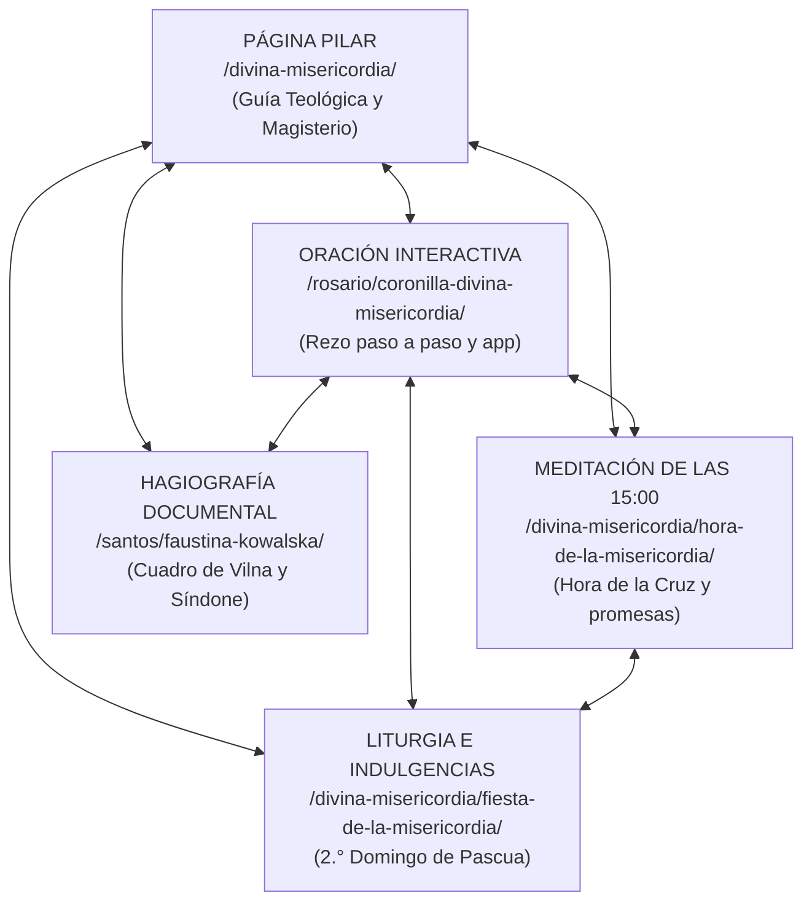

# INFORME EDITORIAL Y TÉCNICO — FASE 8: CONSOLIDACIÓN EDITORIAL Y CLUSTER DE LA DIVINA MISERICORDIA

**Proyecto:** Razón y Asombro (`https://razonyasombro.com/`)  
**Repositorio:** `andrescarrizo1/sitio-catolico`  
**Rama:** `main`  
**Fecha:** 16 de noviembre de 2026  
**Responsable:** CTO, Senior Astro Engineer, SEO Technical Auditor  

---

## 1. ESTADO INICIAL Y DIAGNÓSTICO DEL CONTENIDO

Antes de iniciar la Fase 8, el contenido referente a la Divina Misericordia se encontraba fragmentado en dos páginas principales:
1. **`/rosario/coronilla-divina-misericordia/`**: Guía paso a paso para rezar la Coronilla con el rosario tradicional y aplicación interactiva con soporte para audio y GA4. Contaba con versión en inglés enlazada recíprocamente (`/en/divine-mercy-chaplet/`).
2. **`/santos/faustina-kowalska/`**: Biografía hagiográfica de Santa Faustina Kowalska, centrada en las visiones de Płock (1931), el cuadro original de Vilna (1934) pintado por Eugeniusz Kazimirowski y su correspondencia biométrica milimétrica con la Sábana Santa de Turín.

### Oportunidades y Carencias Detectadas
- **Falta de Página Pilar Temática:** No existía una guía teológica general sobre el misterio de la Divina Misericordia que integrara las enseñanzas magisteriales (San Juan Pablo II, *Dives in Misericordia*) con las cinco formas de devoción confiadas a Santa Faustina.
- **Ausencia de Contenidos Específicos:** Faltaban páginas dedicadas a dos búsquedas de altísima intención devocional y litúrgica:
  - **La Hora de la Misericordia (las 15:00 horas)**: El momento bíblico de la muerte de Jesús en la Cruz y las condiciones dadas en el *Diario* (nn. 1320 y 1572).
  - **La Fiesta de la Divina Misericordia**: La celebración litúrgica del Segundo Domingo de Pascua, las promesas del perdón total de culpas y penas (Diario n. 699) y las condiciones canónicas fijadas por la Santa Sede para la Indulgencia Plenaria (Decreto del 2002).
- **Desconexión del Cluster:** Las páginas existentes no contaban con un enlazado cruzado estructurado que guiara al lector en un itinerario formativo y de oración.

---

## 2. DECISIONES EDITORIALES Y ESTRATEGIA SEO

Para consolidar el cluster temático sin canibalizar tráfico ni romper la arquitectura preexistente:

### Reglas Editoriales Aplicadas:
1. **Preservación de URLs Históricas:** No se creó una URL duplicada para la coronilla (e.g. evitar `/divina-misericordia/coronilla/`). La intención de búsqueda "¿Cómo rezar la coronilla?" se mantiene firmemente consolidada en `/rosario/coronilla-divina-misericordia/`, conservando sus enlaces externos, su tráfico histórico y su paridad hreflang con `/en/divine-mercy-chaplet/`.
2. **Preservación de la Hagiografía:** Santa Faustina permanece como artículo biográfico en la colección de santos (`/santos/faustina-kowalska/`).
3. **Página Pilar de Primer Nivel:** Se estableció `/divina-misericordia/` como el eje formativo del cluster temático, accesible directamente desde el footer y vinculada a todas sus ramificaciones.
4. **Titles y Snippets Optimizados:**
   - `/divina-misericordia/` &rarr; `La Divina Misericordia | Razón y Asombro` (40 caracteres).
   - `/divina-misericordia/hora-de-la-misericordia/` &rarr; `La Hora de la Misericordia: 15:00 hs | Razón y Asombro` (54 caracteres).
   - `/divina-misericordia/fiesta-de-la-misericordia/` &rarr; `Fiesta de la Divina Misericordia | Razón y Asombro` (50 caracteres).
   *Todos estrictamente inferiores al umbral de 60 caracteres para evitar truncamiento en Google SERP.*

---

## 3. FUENTES PRIMARIAS Y RIGOR DOCTRINAL

Se aplicó un estándar de fidelidad documental riguroso, distinguiendo con nitidez la doctrina dogmática de las revelaciones privadas:

1. **Edición Crítica del Diario de Santa Faustina:**
   - Citas verificadas según la edición canónica de la Congregación de las Hermanas de Nuestra Señora de la Misericordia (Cracovia, 2001).
   - Referencias por número de parágrafo exacto:
     - Visión inicial y orden de pintar el cuadro: **nn. 47-48**.
     - Significado sacramental de los rayos (Agua y Sangre): **n. 299**.
     - Origen de la Coronilla en Vilna (septiembre de 1935): **nn. 474-476**.
     - Promesas para la hora de la muerte: **nn. 687 y 1541**.
     - La Fiesta y la remisión total de culpas y penas: **nn. 300 y 699**.
     - La Novena de preparación: **n. 1209**.
     - Mandato de las obras de misericordia: **n. 1317**.
     - La Hora de la Gran Misericordia (15:00 hs): **nn. 1320 y 1572**.
2. **Magisterio de la Iglesia Católica:**
   - San Juan Pablo II: Carta Encíclica *Dives in Misericordia* (30 de noviembre de 1980).
   - San Juan Pablo II: Homilía de Canonización de Santa Faustina Kowalska (*Acta Apostolicae Sedis* 92, 30 de abril de 2000).
   - Congregación para el Culto Divino y la Disciplina de los Sacramentos: Decreto *Misericordia Divina* (5 de mayo de 2000), instituyendo el "Domingo de la Divina Misericordia" en el Calendario Romano General.
   - Penitenciaría Apostólica: Decreto sobre las indulgencias concedidas en la Fiesta de la Divina Misericordia (29 de junio de 2002).
   - Catecismo de la Iglesia Católica: Criterio sobre las revelaciones privadas (n. 67) y el misterio del pecado y la justificación (nn. 1846-1848).
3. **Sagrada Escritura:**
   - Pasajes bíblicos traducidos directamente de la Vulgata Latina por Félix Torres Amat (Madrid, 1825, dominio público): hora novena en San Mateo 27, 45-50; la lanzada y el costado abierto en San Juan 19, 34; la institución de la Penitencia el segundo domingo de Pascua en San Juan 20, 19-23.

---

## 4. ARCHIVOS CREADOS Y MODIFICADOS

### Páginas Creadas (3):
1. [`src/pages/divina-misericordia/index.astro`](file:///c:/Users/Ryzen%205/Desktop/Pagina%20catolica/src/pages/divina-misericordia/index.astro): Página pilar del cluster, teología del perdón, las 5 formas de devoción y criterio doctrinal sobre revelaciones privadas.
2. [`src/pages/divina-misericordia/hora-de-la-misericordia.astro`](file:///c:/Users/Ryzen%205/Desktop/Pagina%20catolica/src/pages/divina-misericordia/hora-de-la-misericordia.astro): Fundamento de la hora novena, citas del Diario (§1320, §1572), las tres condiciones teológicas de la oración y guía para la vida cotidiana.
3. [`src/pages/divina-misericordia/fiesta-de-la-misericordia.astro`](file:///c:/Users/Ryzen%205/Desktop/Pagina%20catolica/src/pages/divina-misericordia/fiesta-de-la-misericordia.astro): Domingo de la Misericordia, promesas del Diario (§699), decreto vaticano de Indulgencia Plenaria y Novena del Viernes Santo.

### Assets Añadidos (1):
- `public/images/jesus-misericordioso-kazimirowski.jpg`: Copia del asset registrado en `LICENCIAS.md` (Dominio Público) para soporte directo de Open Graph y Schema en el cluster.

### Archivos Modificados (4):
1. [`src/pages/rosario/coronilla-divina-misericordia.astro`](file:///c:/Users/Ryzen%205/Desktop/Pagina%20catolica/src/pages/rosario/coronilla-divina-misericordia.astro): Incorporada barra de navegación del cluster, citas de parágrafos del Diario y enlaces contextuales a la Hora y Fiesta.
2. [`src/content/santos/faustina-kowalska.mdx`](file:///c:/Users/Ryzen%205/Desktop/Pagina%20catolica/src/content/santos/faustina-kowalska.mdx): Añadida sección con enlaces al cluster de la Divina Misericordia y citas exactas.
3. [`src/components/global/Footer.astro`](file:///c:/Users/Ryzen%205/Desktop/Pagina%20catolica/src/components/global/Footer.astro): Incorporado enlace sitewide a `/divina-misericordia/` en la columna de contenidos.
4. [`src/components/global/BaseHead.astro`](file:///c:/Users/Ryzen%205/Desktop/Pagina%20catolica/src/components/global/BaseHead.astro): Añadidos los títulos a `knownShortTitles`.

---

## 5. VALIDACIONES Y COMPILACIÓN CI/CD

Se ejecutaron todas las comprobaciones locales obligatorias:

1. **Verificación de Licencias y Enlaces (`npm run check`):**
   - 25 imágenes verificadas y conformes en `LICENCIAS.md`.
   - 0 enlaces rotos detectados en las 55 páginas HTML resultantes.
2. **Tipado Estricto de TypeScript (`npx tsc --noEmit`):**
   - 0 errores de tipado en todo el proyecto.
3. **Diagnóstico de Astro (`astro check`):**
   - 90 archivos analizados: 0 errores, 0 advertencias.
4. **Compilación de Producción (`npm run build`):**
   - 55 páginas HTML generadas estáticamente en 4.19s.
   - Pagefind indexó 55 páginas (6.883 palabras clave en español e inglés).
   - `sitemap-0.xml` generado con **52 URLs canónicas indexables** (incorporando las 3 nuevas rutas de la Divina Misericordia).
5. **Auditoría Automatizada de SEO (`node scripts/ci-verify-seo.mjs`):**
   - ✓ Hreflang 100% recíproco.
   - ✓ Todos los canonicals y alternates apuntan a URLs válidas existentes en `dist/`.
   - ✓ Cero URLs noindex en el sitemap.
   - ✓ Todos los recursos `og:image` y Schema existen físicamente en `dist/`.

---

## 6. URLs DEL CLUSTER DE LA DIVINA MISERICORDIA

| URL Canónica | Tipo de Contenido | Longitud Title | Estado Sitemap |
| :--- | :--- | :---: | :---: |
| `https://razonyasombro.com/divina-misericordia/` | Página Pilar (Guía Teológica) | 40 caracteres | En sitemap-0.xml |
| `https://razonyasombro.com/rosario/coronilla-divina-misericordia/` | Oración Paso a Paso & App | 53 caracteres | En sitemap-0.xml |
| `https://razonyasombro.com/divina-misericordia/hora-de-la-misericordia/` | Guía Devocional (15:00 hs) | 54 caracteres | En sitemap-0.xml |
| `https://razonyasombro.com/divina-misericordia/fiesta-de-la-misericordia/` | Guía Litúrgica e Indulgencias | 50 caracteres | En sitemap-0.xml |
| `https://razonyasombro.com/santos/faustina-kowalska/` | Hagiografía y Cuadro de Vilna | 43 caracteres | En sitemap-0.xml |

---

## 7. PENDIENTES REALES DE INFRAESTRUCTURA

- **Configuración DNS para WWW:** Continúa pendiente la creación manual del registro `CNAME` para `www` apuntando a `razonyasombro.com` con proxy de Cloudflare activo (nube naranja). La lógica de redirección HTTP 301 en el Worker ya está en producción, pero requiere que el DNS autoritativo resuelva el subdominio.
