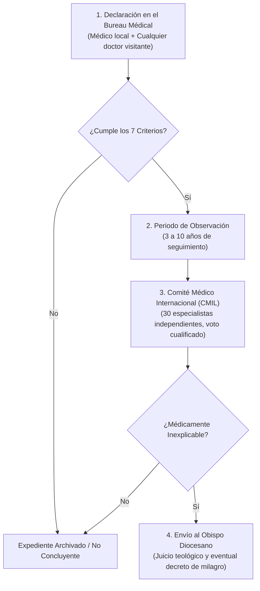

# Expediente Documental 07: El Bureau Médical de Lourdes

**Área de Investigación:** Medicina Clínica, Protocolos de Verificación de Curaciones Inexplicables  
**Ubicación:** Santuario de Nuestra Señora de Lourdes, Altos Pirineos (Francia)  
**Estatus Eclesial:** Institución médica secular oficial del Santuario; asesora a los obispos diocesanos del mundo en el discernimiento de curaciones extraordinarias.

---

## 1. Resumen Ejecutivo
Fundado en 1883 por el Dr. Georges-Fernand Dunot de Saint-Maclou, el *Bureau des Constatations Médicales* de Lourdes es el tribunal clínico más antiguo y riguroso del mundo dedicado a evaluar curaciones alegadas en un contexto de peregrinación religiosa. Su característica metodológica fundamental es que está abierto a cualquier médico o cirujano colegiado del mundo, con independencia de sus convicciones religiosas o filosóficas (ateos, agnósticos, musulmanes, judíos o protestantes). Desde 1858 se han presentado más de 7.000 expedientes clínicos en sus oficinas; sin embargo, tras pasar por los filtros de los 7 criterios médicos clásicos del Cardenal Prospero Lambertini (Papa Benedicto XIV) y el escrutinio del Comité Médico Internacional de Lourdes (CMIL, creado en 1954), **únicamente 70 curaciones han sido proclamadas formalmente como milagrosas** por los obispos de las diócesis de origen de los enfermos hasta la fecha.

---

## 2. Cronología Documentada
* **1858:** Apariciones a Bernadette Soubirous en la Gruta de Massabielle y primeros informes de curaciones espontáneas con el agua del manantial.
* **1883:** Creación formal del *Bureau des Constatations Médicales* por iniciativa médica para someter los testimonios a rigor diagnóstico pre y post.
* **1905:** El Papa San Pío X respalda el principio de que los médicos dictaminan exclusivamente si la curación es científicamente inexplicable, dejando el juicio de la sobrenaturalidad a la autoridad eclesiástica.
* **1954:** Creación del *Comité Médical International de Lourdes* (CMIL), integrado por unos 30 especialistas médicos de renombre universitario europeo (profesores de oncología, neurología, traumatología, etc.).
* **11 de febrero de 2018:** Mons. Jacques Benoit-Gonnin (Obispo de Beauvais) proclama la curación milagrosa número 70 (Sor Bernadette Moriau, curada en 2008 de un síndrome severo de la cola de caballo que la mantenía paralítica).

---

## 3. Fuentes Primarias
1. **Los 7 Criterios del Cardenal Prospero Lambertini (Papa Benedicto XIV):**
   - *Obra fuente:* *De Servorum Dei beatificatione et Beatorum canonizatione* (Libro IV, Cap. VIII, Bolonia, 1734–1738):
     1. La enfermedad debe ser grave, orgánica (no funcional o psicosomática) y de pronóstico fatal o pésimo.
     2. El diagnóstico debe ser médicamente cierto y verificado con pruebas objetivas (radiografías, biopsias, análisis clínicos).
     3. No debe haber mediado un tratamiento médico que pueda explicar razonablemente la curación.
     4. La curación debe ser instantánea y repentina.
     5. El restablecimiento funcional y anatómico debe ser completo y perfecto.
     6. No debe haber habido crisis previa o fase de convalecencia gradual.
     7. La curación debe ser duradera y definitiva, sin recaídas tras años de observación médica continuada.
2. **Archivos Clínicos del Bureau Médical de Lourdes:**
   - Expedientes digitalizados bajo la dirección del Dr. Alessandro de Franciscis (Presidente actual del Bureau).
3. **Análisis Químico del Manantial de Lourdes (1858):**
   - *Autor:* Prof. Édouard Filhol (Profesor de Química de la Facultad de Ciencias de Toulouse).
   - *Dictamen:* El agua es agua mineral potable ordinaria sin sustancias farmacológicas, radiactivas ni propiedades terapéuticas activas intrínsecas.

---

## 4. Fuentes Secundarias
* De Franciscis, Alessandro. *Guarire a Lourdes: La voce dei medici di fronte al mistero*. Edizioni San Paolo, 2018.
* Mangiapan, Théodore. *Les guérisons de Lourdes: Étude historique et critique*. Euvre de la Grotte, 1994.
* Laurentin, René. *Lourdes: Dossier des documents authentiques* (7 vols.). Lethielleux, 1957–1966.

---

## 5. El Procedimiento de Escrutinio en 4 Fases

---

## 6. Objeciones Médicas y Respuestas
1. **Remisiones Espontáneas:** Los escépticos argumentan que en oncología o neurología existen casos rarísimos de remisión espontánea.  
   *Respuesta del CMIL:* El comité no evalúa remisiones estadísticas lentas, sino reconstrucciones anatómicas instantáneas (por ejemplo, regeneración inmediata de tejido óseo destruido por osteomielitis o restitución neurológica funcional tras años de parálisis irreversible, como en el caso de Vittorio Micheli en 1963).
2. **Efecto Placebo o Trastornos Somatomorfos:**  
   *Respuesta del Bureau:* Los trastornos de conversión histérica o dolores neuropáticos funcionales quedan descartados de plano en el Criterio 1: solo se admiten patologías orgánicas con destrucción tisular objetivada mediante anatomía patológica, TAC o resonancia magnética.

---

## 7. Grado de Certeza Epistémica

| Afirmación | Categoría Epistémica |
|---|---|
| Dios puede realizar milagros sobre las leyes de la naturaleza | **1. Dogma de fe** |
| El Bureau Médical de Lourdes existe y funciona desde 1883 | **4. Hecho histórico documentado** |
| Se han registrado más de 7.000 declaraciones y solo 70 milagros | **4. Hecho histórico documentado (estadística oficial)** |
| Una curación concreta es inexplicable para la ciencia médica moderna | **7. Hipótesis científica / Veredicto pericial CMIL** |
| La curación fue un milagro obrado por intercesión de la Virgen María | **8. Interpretación teológica / Decreto episcopal (3)** |
| El agua de Lourdes tiene componentes químicos con propiedades milagrosas | **9. Afirmación no demostrada (REFUTADA POR LA CIENCIA)** |

---

## 8. Afirmaciones que NO Deben Publicarse (Bulos y Errores)
* ❌ **Falso:** *"En Lourdes cualquier enfermo que dice sentirse aliviado es declarado milagro"*.  
  *Realidad:* La tasa de reconocimiento eclesiástico es de menos del 1% de los casos presentados, lo que demuestra la extrema prudencia y rigor de los peritos médicos.
* ❌ **Falso:** *"El Comité Médico de Lourdes está formado por sacerdotes católicos disfrazados de doctores"*.  
  *Realidad:* Los médicos del CMIL son profesores universitarios laicos en ejercicio en hospitales públicos de Europa y Norteamérica; muchos de ellos no son creyentes.
* ❌ **Falso:** *"El agua de Lourdes contiene un mineral desconocido descubierto por la ciencia"*.  
  *Realidad:* Es agua natural de montaña absolutamente ordinaria; la curación no proviene de un mecanismo farmacológico, sino de la gracia sobrenatural unida a la fe y la oración.

---

## 9. Bibliografía y Enlaces Verificables
* Santuario de Nuestra Señora de Lourdes (Bureau Médical): [lourdes-france.org](https://www.lourdes-france.org/es/sanctuaire-lourdes-guerisons-miracles/)
* De Franciscis, A. (Presidente del Bureau des Constatations Médicales).
* Archivos del Dicasterio para las Causas de los Santos: [causesanti.va](http://www.causesanti.va/)
