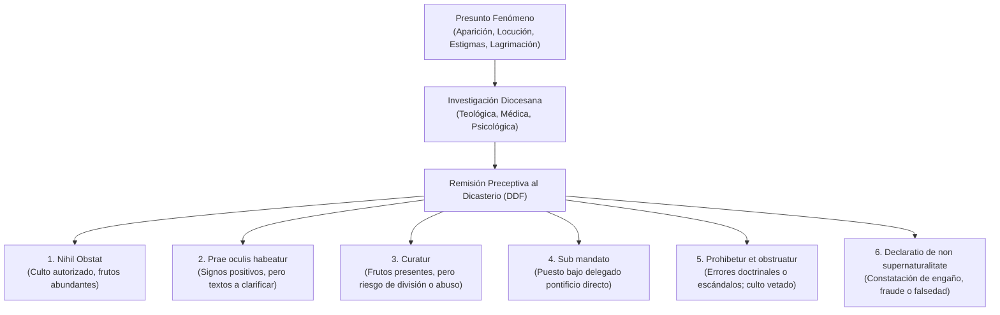

# Expediente Documental 12: Las Nuevas Normas del Vaticano sobre Fenómenos Sobrenaturales (Mayo 2024)

**Área de Investigación:** Derecho Canónico, Teología Fundamental y Magisterio Pontificio  
**Emisor:** Dicasterio para la Doctrina de la Fe (Santa Sede), con aprobación formal del Papa Francisco  
**Estatus Eclesial:** Documento legislativo vinculante para toda la Iglesia Católica universal (promulgado el 17 de mayo de 2024; en vigor desde el 19 de mayo de 2024, Domingo de Pentecostés).

---

## 1. Resumen Ejecutivo
El 17 de mayo de 2024, el Dicasterio para la Doctrina de la Fe (DDF), presidido por el Cardenal Víctor Manuel Fernández, publicó las nuevas *Normas para proceder en el discernimiento de presuntos fenómenos sobrenaturales*, sustituyendo el reglamento previo de 1978 emitido por el Papa San Pablo VI. El documento introduce un cambio de paradigma histórico en la disciplina eclesiástica: por regla general, ni el obispo diocesano ni el Vaticano declararán formalmente que un fenómeno es de origen sobrenatural auténtico (*constat de supernaturalitate*), potestad que queda reservada con exclusividad al Romano Pontífice para situaciones excepcionales. En su lugar, el juicio de la Iglesia se centrará en evaluar la salud doctrinal de los mensajes y los frutos espirituales de la devoción mediante seis posibles calificaciones conclusivas, exigiendo siempre la aprobación previa preceptiva del Dicasterio antes de cualquier publicación oficial.

---

## 2. Cronología Documentada
* **25 de febrero de 1978:** La Sagrada Congregación para la Doctrina de la Fe (Cardenal Franjo Šper) promulga las normas previas bajo el pontificado de Pablo VI (mantenidas inicialmente bajo secreto pontificio y publicadas formalmente en 2011).
* **2019–2023:** El Dicasterio para la Doctrina de la Fe constata la proliferación descontrolada de presuntos videntes, mensajes apocalípticos, lacrimaciones y fraudes amplificados por las redes sociales y transmisiones de internet.
* **4 de mayo de 2024:** El Papa Francisco aprueba formalmente las nuevas normas en audiencia concedida al Prefecto del Dicasterio.
* **17 de mayo de 2024:** Conferencia de prensa en la Sala Stampa del Vaticano y publicación oficial del texto normativo en seis idiomas.
* **19 de mayo de 2024:** Entrada en vigor universal en la Solemnidad de Pentecostés.

---

## 3. Fuentes Primarias
1. **Documento Oficial del Dicasterio para la Doctrina de la Fe:**
   - *Título latino:* *Normae ad procedendum in iudicandis praesumptis apparitionibus ac revelationibus*.
   - *Título oficial en español:* *Normas para proceder en el discernimiento de presuntos fenómenos sobrenaturales*.
   - *Firmantes:* Víctor Manuel Cardenal Fernández (Prefecto) y Mons. Armando Matteo (Secretario para la Sección Doctrinal).
   - *Aprobación:* *Ex Audientia Die 4.05.2024*, Franciscus.
2. **Presentación Doctrinal del Cardenal Víctor Manuel Fernández:**
   - Introducción teológica que explica las razones pastorales de la reforma (evitar la instrumentalización económica, el control sectario y el engaño de los fieles).

---

## 4. Las Seis Nuevas Conclusiones Canónicas

El nuevo marco normativo reemplaza la dicotomía tradicional (*constat / non constat*) por seis grados de discernimiento pastoral:

### Definición de cada grado:
1. ***Nihil obstat* (Nada se opone):** Se reconoce la acción del Espíritu Santo en medio de la experiencia; no hay elementos contrarios a la fe o a la moral; se estimula y permite la devoción pública, peregrinaciones y celebraciones litúrgicas.
2. ***Prae oculis habeatur* (Téngase ante los ojos):** Se aprecian signos positivos importantes, pero se advierten elementos de confusión, ambigüedad teológica o expresiones que exigen clarificación prudente.
3. ***Curatur* (Trátese / Cuídese con atención):** Existen frutos espirituales evidentes, pero coexisten con tensiones, polémicas o intentos de manipulación de terceros; no se prohíbe el santuario, pero se evita la publicidad engañosa.
4. ***Sub mandato* (Bajo mandato superior):** Los problemas no se derivan del fenómeno en sí, sino del uso indebido que hacen grupos o personas; la Santa Sede o el obispo asumen el gobierno directo a través de un delegado especial.
5. ***Prohibetur et obstruatur* (Prohíbase y obstaculícese):** Se detectan graves errores doctrinales, desviaciones morales, manipulación de conciencias o afán de lucro evidente; se prohíbe taxativamente la adhesión y la difusión.
6. ***Declaratio de non supernaturalitate* (Declaración de no sobrenaturalidad):** El obispo, con aval del Dicasterio, declara fundado en pruebas objetivas (confesión del presunto vidente, peritaje que detecta tinte artificial, cámara oculta) que el hecho no es de origen sobrenatural.

---

## 5. Criterios Positivos y Negativos de Evaluación

### Criterios Positivos (Art. 14):
* Certeza moral sobre la credibilidad e integridad psíquica de las personas implicadas (ausencia de histeria, fabulación o psicosis).
* Rectitud moral y vida cristiana ejemplar de los videntes.
* Ortodoxia doctrinal del mensaje (total fidelidad a la Sagrada Escritura y la Tradición).
* Frutos espirituales sanos y duraderos: conversiones auténticas, aumento de la oración, obras de caridad, vocaciones consagradas.

### Criterios Negativos (Art. 15):
* Manifiesto afán de lucro, venta de objetos sagrados o recaudación de dinero ligada al fenómeno.
* Desórdenes morales o sexuales graves de los promotores o videntes.
* Psicopatologías, alucinaciones o tendencias mitómanas documentadas clínicamente.
* Errores doctrinales graves contra el dogma católico o ataques contra la comunión jerárquica de la Iglesia.

---

## 6. Grado de Certeza Epistémica

| Afirmación | Categoría Epistémica |
|---|---|
| La Revelación pública y universal de Dios quedó concluida con la muerte del último Apóstol | **1. Dogma de fe** (Concilio Vaticano II, *Dei Verbum*, n. 4) |
| Las Normas del 17 de mayo de 2024 son ley canónica vigente | **3. Enseñanza / Legislación del Magisterio pontificio** |
| La Iglesia no declara casi nunca la sobrenaturalidad intrínseca | **3. Disciplina canónica oficial actual** |
| Las revelaciones privadas pueden ayudar a la fe, pero no completan la Revelación | **2. Doctrina católica (Catecismo n. 67)** |
| Un católico comete pecado mortal si no cree en una aparición que tiene *Nihil obstat* | **9. Afirmación no demostrada (TOTALMENTE FALSA)** |

---

## 7. Afirmaciones que NO Deben Publicarse (Bulos y Errores)
* ❌ **Falso:** *"El Vaticano decretó que los milagros y apariciones ya no existen en el mundo contemporáneo"*.  
  *Realidad:* El Vaticano reconoce explícitamente que Dios y la Virgen continúan actuando con signos en la historia; lo que cambia es la prudencia canónica para no comprometer la autoridad de la Iglesia declarando 'hecho sobrenatural infalible' lo que pertenece a la experiencia humana.
* ❌ **Falso:** *"El obispo local puede aprobar una aparición por su cuenta sin consultar a Roma"*.  
  *Realidad:* Las nuevas normas prohíben estrictamente al obispo diocesano emitir cualquier juicio público sin la previa aprobación escrita del Dicasterio para la Doctrina de la Fe.

---

## 8. Bibliografía y Enlaces Verificables
* Texto Íntegro de las Normas (17 de mayo de 2024): [vatican.va/.../ddf_norme-fenomeni-soprannaturali_20240517.html](https://www.vatican.va/roman_curia/congregations/cfaith/documents/rc_ddf_doc_20240517_norme-fenomeni-soprannaturali_sp.html)
* Boletín de la Sala de Prensa de la Santa Sede (17 de mayo de 2024): [press.vatican.va](https://press.vatican.va/)
