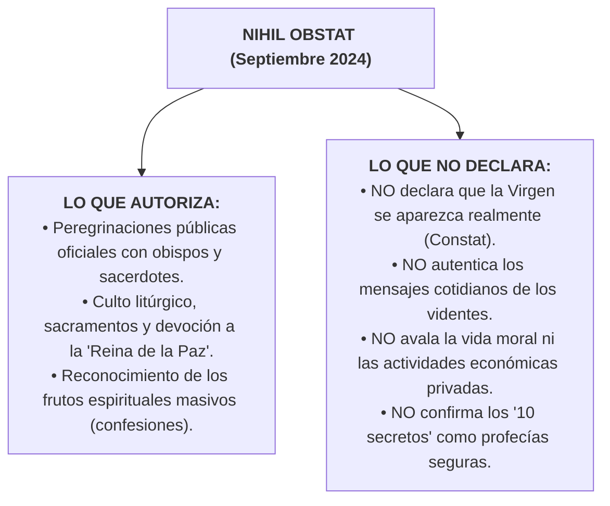

# Expediente Documental 13: El Nihil Obstat de Medjugorje (Septiembre 2024)

**Área de Investigación:** Teología Dogmática, Discernimiento Pastoral y Fenomenología Mariana  
**Ubicación:** Parroquia de Santiago Apóstol, Medjugorje, Diócesis de Mostar-Duvno (Bosnia y Herzegovina)  
**Estatus Eclesial:** Concesión oficial del *Nihil obstat* pastoral mediante la Nota Doctrinal *"La Reina de la Paz"* del Dicasterio para la Doctrina de la Fe (19 de septiembre de 2024).

---

## 1. Resumen Ejecutivo
El 19 de septiembre de 2024, el Dicasterio para la Doctrina de la Fe (DDF) publicó la Nota Doctrinal *"La Reina de la Paz"* sobre la experiencia espiritual de Medjugorje, firmada por el Cardenal Víctor Manuel Fernández con aprobación expresa del Papa Francisco. Aplicando por primera vez las nuevas *Normas para el discernimiento de fenómenos sobrenaturales* de mayo de 2024, la Santa Sede otorgó la calificación de **Nihil obstat**. Esta decisión autoriza plenamente las peregrinaciones diocesanas oficiales y el culto público en el santuario, reconociendo los abundantes y comprobados frutos espirituales (conversiones, reconciliación sacramental masiva, vocaciones sacerdotales y obras de caridad). Sin embargo, el documento subraya enfáticamente que **el *Nihil obstat* NO implica una declaración de que las apariciones sean sobrenaturales ni autentica la vida moral o los mensajes futuros de los presuntos videntes**, señalando además textos específicos que contienen ambigüedades teológicas que deben leerse con cautela crítica.

---

## 2. Cronología Documentada
* **24 de junio de 1981:** Seis niños y adolescentes del pueblo de Medjugorje (entonces Yugoslavia comunista) afirman haber visto a la *Gospa* (la Virgen María) en la colina de Podbrdo.
* **1982–1990:** Comisiones diocesanas de Mostar dirigidas por Mons. Pavao Žanić concluyen con juicio negativo sobre la sobrenaturalidad.
* **10 de abril de 1991:** Declaración de Zadar de los obispos de la ex Yugoslavia: *"Non constat de supernaturalitate"* (no consta la sobrenaturalidad), aunque se reconoce el flujo de peregrinos.
* **2010–2014:** Benedicto XVI crea la Comisión Internacional de Investigación en la Congregación para la Doctrina de la Fe presidida por el Cardenal Camillo Ruini (Informe Ruini: favorable a la autenticidad de las primeras siete apariciones de 1981; escéptica sobre las apariciones posteriores continuadas).
* **2017:** El Papa Francisco nombra a Mons. Henryk Hoser (y luego a Mons. Aldo Cavalli en 2021) como Visitador Apostólico de carácter especial para la parroquia de Medjugorje.
* **12 de mayo de 2019:** El Papa Francisco autoriza oficialmente las peregrinaciones organizadas por diócesis y parroquias.
* **28 de agosto de 2024:** El Papa Francisco aprueba la Nota Doctrinal del Dicasterio.
* **19 de septiembre de 2024:** Publicación mundial de la Nota *"La Reina de la Paz"*, otorgando el *Nihil obstat*.

---

## 3. Fuentes Primarias
1. **Nota Doctrinal *"La Reina de la Paz"* (19 de septiembre de 2024):**
   - *Emisor:* Dicasterio para la Doctrina de la Fe (Cardenal Víctor Manuel Fernández y Mons. Armando Matteo).
   - *Aprobación:* Papa Francisco (*Ex Audientia*, 28 de agosto de 2024).
   - *Contenido:* Análisis teológico de los mensajes marianos (paz, fe, oración, conversión, ayuno) y señalamiento de pasajes controvertidos.
2. **Informe de la Comisión Internacional Ruini (2014):**
   - Voto de la comisión vaticana sobre las primeras apariciones (13 votos a favor de la sobrenaturalidad inicial; división y reservas sobre la prolongación cotidiana de los mensajes).
3. **Declaración de Zadar (1991):**
   - Conferencia Episcopal de Yugoslavia.

---

## 4. El Alcance Exacto del *Nihil Obstat*

La Nota vaticana de 2024 establece con precisión quirúrgica qué se aprueba y qué no:

---

## 5. Críticas Doctrinales y Limitaciones Señaladas por el Vaticano
La Nota del Cardenal Fernández identifica con rigor elementos problemáticos en los presuntos mensajes que **deben ser purificados**:
1. **Reprensiones al Obispo Diocesano:** Mensajes donde la presunta aparición tomaba partido en disputas de jurisdicción eclesiástica local contra el obispo de Mostar, lo cual contradice la comunión eclesial católica.
2. **Autorreferencialidad de la Aparición:** Expresiones donde la figura insistía excesivamente en escuchar sus propios mensajes por encima de la mediación eclesial ordinaria.
3. **Frecuencia Incesante y Agendas Programadas:** La pretensión de que la Virgen se aparezca a una hora fija diaria con mensajes sobre temas administrativos o cotidianos menores desdibuja la majestad y sobriedad de las apariciones bíblicas y marianas tradicionales.

---

## 6. Grado de Certeza Epistémica

| Afirmación | Categoría Epistémica |
|---|---|
| María es la Reina de la Paz y mediadora de gracias | **2. Doctrina católica / Piedad litúrgica** |
| El *Nihil obstat* fue concedido el 19 de septiembre de 2024 | **4. Hecho histórico documentado (Nota DDF)** |
| Se reconocen frutos positivos de conversión y sacramentos | **3. Enseñanza / Juicio pastoral del Magisterio pontificio** |
| Los mensajes deben leerse con discernimiento teológico crítico | **3. Mandato formal del Magisterio pontificio** |
| La Iglesia católica declaró que la Virgen María se aparece en Medjugorje | **9. Afirmación no demostrada (FALSA; el DDF evitó explícitamente esta declaración)** |
| Los 10 secretos son dogmas del futuro de la humanidad | **9. Afirmación no demostrada (Especulación no respaldada)** |

---

## 7. Afirmaciones que NO Deben Publicarse (Bulos y Errores)
* ❌ **Falso:** *"El Papa Francisco declaró que las apariciones de Medjugorje son 100% verdaderas y aprobadas como las de Lourdes o Fátima"*.  
  *Realidad:* El Vaticano aclaró explícitamente que no emitió una declaración de *Constat de supernaturalitate*. El *Nihil obstat* reconoce los frutos pastorales, no la certeza de las visiones.
* ❌ **Falso:** *"Los fieles tienen obligación de obedecer los mensajes mensuales que transmiten los videntes"*.  
  *Realidad:* El Vaticano prohíbe considerar los mensajes como mandatos obligatorios y advierte que los peregrinos no deben acudir a Medjugorje con la motivación de encontrarse con los videntes.

---

## 8. Bibliografía y Enlaces Verificables
* Dicasterio para la Doctrina de la Fe: Nota Doctrinal *"La Regina della Pace"* (19 de septiembre de 2024): [vatican.va](https://www.vatican.va/roman_curia/congregations/cfaith/documents/rc_ddf_doc_20240919_nota-regina-della-pace_sp.html)
* Boletín de la Oficina de Prensa de la Santa Sede (19 de septiembre de 2024): [press.vatican.va](https://press.vatican.va/)
